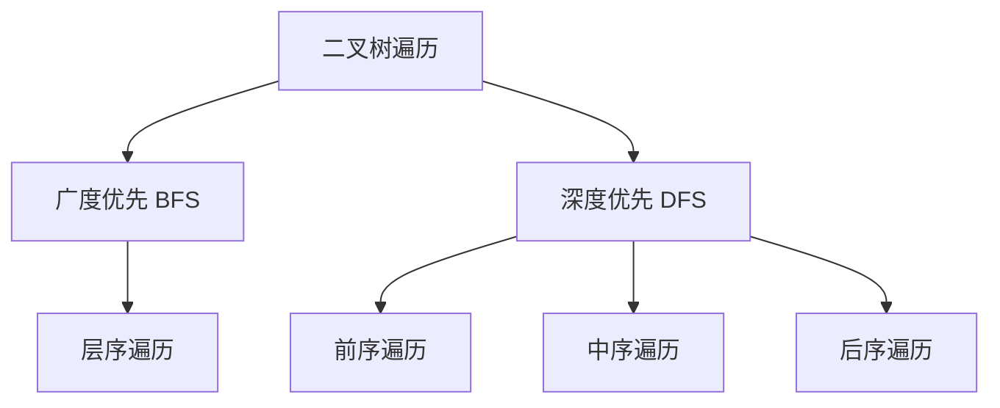
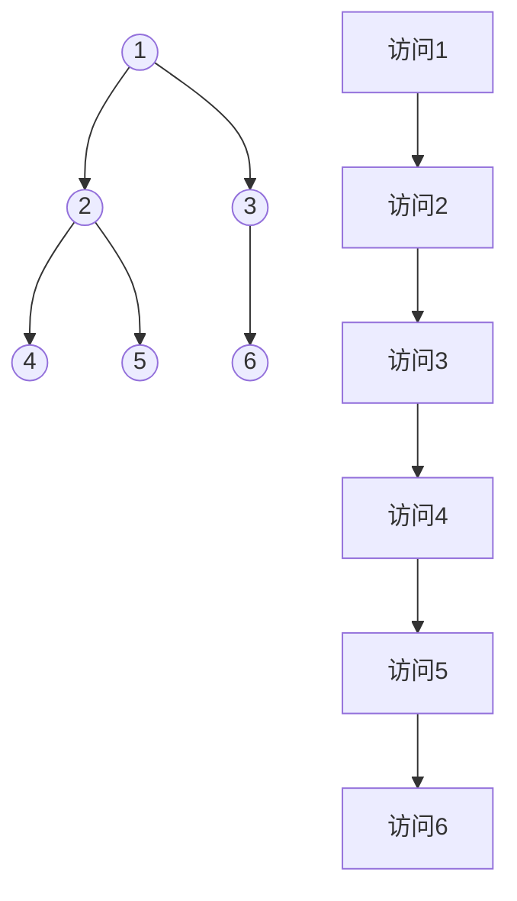

# 面试技巧

## 简历准备

Boss是不能先发送简历附件的，要填写线上简历+打招呼内容。（但是可以把简历转成图片发出去说是）

## 个人介绍

主要围绕在讲项目实习的经历，讲一些稍微有技术亮点且你会的东西。

```
    面试官您好，我是秦松云，就读桂林电子科技大学计算机信息安全学院，很高兴能参加贵司面试。
    我的核心技术栈包括Vue/React，同时也有过React-Native/UniApp/Electron开发经验，熟悉常见的响应式设计和前端性能优化。
    我有过两段实习经历：在中国科学院软件研究所实习中，我主要参与项目页面与组件编写，实现如大文件上传等功能；在云合智网实习中，实现AntvG6图表化网络层，参与部分代码重构与前端优化，达到处理时间减少80%。
    我有自己写过若干项目：在Tasklist项目中，我担任全栈开发者角色，项目使用Vue+fastApi，实现主题切换、双token认证登录等。在Perfect Studio项目中，主要使用微信小程序开发工具+微信云后端，实现白屏优化、首页加载优化、懒加载等。在智能灌溉项目中，项目使用RN+express，完成数据图表可视化和部分移动端适配。
    以上就是我的个人介绍，期待后续详细交流。
```

# 计算机基础

## 操作系统

### 操作系统简介

我接下来分点且尽可能简明介绍。

操作系统是什么：他是一个管家，用来管理计算机的软硬件资源。

操作系统的核心功能：

+ 处理器(CPU)管理：操作系统合理安排任务的执行顺序，让CPU能够高效地处理各种任务，避免冲突。
+ 内存管理：程序运行的时候需要操作系统分配合理的内存空间，也会回收内存。
+ 设备管理：管理外部设备。
+ 文件系统管理：操作系统提供了文件系统来存储和读取文件。

### 进程和线程

举个例子吧：

有一个商场，商场里有很多店，有麦当劳，有书店。但是商场里的店有限，因为一个店要占很大的位置。有一天书店跳闸了，但是麦当劳还有电做麦旋风。第二天书店被抢劫了，但是麦当劳还是能做麦旋风。

上面这个例子中，店铺就是进程，他是资源分配的单位。店铺要占很大位置对应资源消耗大的特点，书店跳闸麦当劳不受影响对应隔离性的特点，抢劫对应安全性的特点。

接着举例子：

有一天，麦当劳收到一个麦旋风的订单，专送外卖员已经准备好了，但是麦旋风还没有做出来。我就吃不到麦旋风！！！

这里的制作麦旋风、送外卖就是线程，他是程序的具体执行。从上面例子可以看出，线程之间是相互影响的。

## 计算机网络

### OSI七层协议与TCP/IP四层协议

#### OSI七层协议

OSI是开放系统互连参考模型，只是一个很常用的参考。

OSI有应用层、表示层、会话层、传输层、网络层、数据链路层、物理层。

物理层：负责实际运输数据的物理媒介，确保数据信号能够在物理介质（如电线、光纤等）上传输。

数据链路层：将物理层接收到的原始信号转换为数据帧，并进行错误检测和纠正，确保数据在相邻节点之间可靠地传输，同时利用 MAC 地址来标识不同的设备。

网络层：通过 IP 地址来标识不同的网络和设备，选择合适的路径将数据包从源节点发送到目标节点，并进行路由选择和寻址。

传输层：将数据分割成合适大小的段，并为每个段添加源端口和目的端口信息，以确保数据能够准确地发送到目标设备上的正确应用程序。同时，它还负责对数据进行错误检测和重传，保证端到端的可靠通信。

会话层：负责建立、维护和管理通信双方之间的会话连接。它允许不同的应用程序之间进行对话，并确保会话的正常进行和有序结束。

表示层：对数据进行加密、解密、压缩和解压缩等操作，确保数据在传输过程中的安全性和高效性，并将数据转换为适合应用程序使用的格式。

应用层：为用户和应用程序提供各种网络服务和接口，如电子邮件、文件传输、网页浏览等。它是用户与网络进行交互的最直接的一层。

有点麻烦，举个例子吧：

你网购了一个墩墩鸡抱枕，客服**(应用层)**收到你的你的订单，对产品进行打包**(表示层)**，客服和快递员沟通**(会话层)**要寄出你的墩墩鸡，快递驿站对收到的好多包裹进行打包贴标签**(传输层)**，确保不会弄混，接着通过当地的转运站寄出**(网络层)**，当地转运站到下一个转运站要走系统规划好的路**(数据链路层)**，都确定好之后你的货车开始发车**(物理层)**。

#### TCP/IP四层协议

四层协议是七层协议的简化。

其中：

**应用层** + **表达层** + **会话层** = **应用层**

应用层常见的协议有：HTTP、FTP、SMTP

**传输层** = **传输层**

传输层常见的协议有：TCP、UDP

**网络层** = **网络层**

**数据链路层** + **物理层** = **链路层**

### HTTP

#### HTTP与HTTPS

HTTP是超文本传输协议，是一个用于传输文本的协议，但是他不安全，容易被截取。

这个时候在HTTP加装一个SSL协议用于提供数据安全和完整性，SSL采用非对称加密算法，SSL会让服务器返回一个安全证书，证书内包含公钥，一并发给浏览器，浏览器对每次返回的数据进行公钥加密，服务器拿到数据包后进行私钥解密。

#### HTTP内容

HTTP 请求的内容包括请求行、请求头和请求体。

+ `请求行`：用于说明请求类型、要访问的资源以及使用的 HTTP 协议版本。
+ `请求头`：包含一些发送请求时的附加信息，例如`Host`、`Accept-Encoding`、`Content-Type`
+ `请求体`：包含客户端发送给服务器的数据。

HTTP 响应的内容包括响应行、响应头和响应体。

+ `响应行`：HTTP/版本号+状态码
+ `响应头`：包含一些返回数据的附加信息，比如`Date`、`Connection`、`Content-Type`
+ `响应体`：包含服务器返回的数据。

#### HTTP版本

+ `HTTP/0.9`：1991年发布，只支持GET方法，没有版本号、请求头、响应头、状态码。
+ `HTTP/1.0`：1996年发布
  + 添加POST方法等
  + 添加版本号、请求头、响应头、状态码
  + 连接不能复用，效率低。
+ `HTTP/1.1`：1997年发布（记成持久(持久连接)关(管道化)注(主机头字段)）
  + **持久连接** ：默认情况下，TCP 连接在一次请求 / 响应后不会立即关闭，可以被多个请求 / 响应复用，减少了建立和关闭连接的开销。
  + **管道化** ：客户端可以在同一个连接上发送多个请求，而不用等待每个请求的响应返回，提高了效率，但服务器端仍需按顺序处理这些请求。
  + **主机头字段** ：支持虚拟主机，通过 Host 请求头字段来区分不同的域名，使得在同一个 IP 地址上可以部署多个网站。
+ `HTTP/2`：2015年发布（记成耳(二进制协议)朵(多路复用)押(头部压缩)送(服务器推送)）
  + **二进制协议** ：对数据传输进行了优化，将原本的文本形式改为二进制形式，减少了解析的开销。
  + **多路复用** ：允许多个请求和响应可以同时在一个连接上交错传输，避免了 HTTP/1.1 中的队头阻塞问题，大大提高了传输效率。
  + **头部压缩** ：采用 HPACK 压缩算法对请求和响应的头部进行压缩，减少了头部信息所占用的网络带宽。
  + **服务器推送** ：服务器可以主动推送一些客户端可能需要的资源到客户端，而无需客户端逐一请求，可以提前获取资源，优化了性能。
+ `HTTP/3`：2022年发布
  + **基于 UDP 协议** ：克服了 TCP 协议的一些限制，如慢启动、队列阻塞等，能够更快地建立连接并传输数据，适合实时性要求较高的场景。
  + **使用 QUIC 协议** ：在 UDP 的基础上提供了像 TCP 一样的可靠性保证，同时具备低延迟、连接迁移等特性。即使客户端的网络环境发生变化（如从 Wi-Fi 切换到移动数据），连接也不会中断。
  + **进一步优化性能** ：在 HTTP/2 的基础上继续优化，如改进了头部压缩算法，进一步提高了传输效率。

#### HTTP状态码

`1xx`：表示请求已被接受，需要继续处理。

`2xx`：表示请求已成功被服务器接收、理解、并接受。

`3xx`：表示要完成请求，需要进一步操作。 通常，这些状态代码用来重定向。

`4xx`：表示客户端看起来可能发生了错误，妨碍了服务器的处理。

`5xx`：表示服务器无法完成明显有效的请求。

#### GET与POST

一般来说使用GET是不带参数的，如果要带上参数的话，使用`URL 查询参数`来实现。如果要带上参数，常见的场景是搜索栏。因为GET带有的参数是显露在url中的，所以POST会相较于GET更加安全。他们本质上都是TCP连接，没有什么差别。

### TCP与UDP

UDP，用户数据包协议，是一个简单的**面向数据报的通信协议**，他不提供复杂的控制机制，利用 IP 提供面向无连接的通信服务，传输途中出现丢包，UDP 也不负责重发。当包的到达顺序出现乱序时，UDP没有纠正的功能。即使是出现网络拥堵的情况，UDP 也无法进行流量控制等避免网络拥塞行为。好处是快！很快！非常快！

TCP，传输控制协议，是一种可靠、**面向字节流的通信协议**，把上面应用层交下来的数据看成无结构的字节流来发送。TCP充分地实现了数据传输时各种控制功能，可以进行丢包时的重发控制，还可以对次序乱掉的分包进行顺序控制。而这些在 UDP 中都没有。但是TCP 只能点对点全双工通信。UDP 支持一对一、一对多、多对一和多对多的交互通信。

#### TCP三次握手

三次握手（Three-way Handshake）其实就是指建立一个TCP连接时，需要客户端和服务器总共发送3个包。主要作用就是为了确认双方的接收能力和发送能力是否正常、指定自己的初始化序列号为后面的可靠性传送做准备。

+ 第一次握手：客户端发送网络包，服务端收到了。
  
  这样服务端就能得出结论：客户端的发送能力、服务端的接收能力是正常的

+ 第二次握手：服务端发包，客户端收到了。
  
  这样客户端就能得出结论：服务端的接收、发送能力，客户端的接收、发送能力是正常的。不过此时服务器并不能确认客户端的接收能力是否正常

+ 第三次握手：客户端发包，服务端收到了。
  
  这样服务端就能得出结论：客户端的接收、发送能力正常，服务器自己的发送、接收能力也正常。

### DNS协议

DNS（Domain Name System，域名系统）协议是一种用于将域名转换为IP地址的网络协议。将易记的域名（如`example.com`）转换为计算机用于通信的IP地址（如`192.168.1.1`），方便用户记忆和访问网站。

### WebSocket

WebSocket，是一种网络传输协议，位于`OSI`模型的应用层。可在单个`TCP`连接上进行全双工通信，能更好的节省服务器资源和带宽并达到实时通迅。

客户端和服务器只需要完成一次握手，两者之间就可以创建持久性的连接，并进行双向数据传输。

+ WS首次握手是一个标准的HTTP GET请求，但是带上了`Upgrade:websocket`和`Connection:Upgrade`头，返回101后协议升级为WS，走WS自己的二进制帧格式。
+ WS鉴权靠握手时带 `Cookie/Token` 或后续消息验证，没有统一的标准。
+ WS实现SSL协议的安全连接就是WS over TLS，证书+443端口即可，实现与HTTPS相同。

### 跨域

浏览器中有一个重要的安全策略，叫做同源策略，**同源策略是指，若页面的源和页面运行过程中加载的源不一致时，出于安全考虑，浏览器会对跨域的资源访问进行一些限制**

> 源 = 协议 + 主机 + 端口，如果源相同就叫同源，否则称为跨域。

常见的解决方法有三种：

+ 代理：（使用场景：生产环境不跨域，开发环境跨域。）对开发服务器进行proxy配置即可。
+ CORS：`http1.1`适用
  + 当请求方法属于GET/POST/HEAD、请求头仅包含安全的字段、Content-type中仅为限定值时，视为简单请求，请求头会添加`Origin`字段，响应头会添加``Access-Control-Allow-Origin``字段，以确定该源可不可以访问。
  + 如果浏览器不认为这是一种简单请求，则会发送一个预检请求，包含请求相关信息（没有请求体），服务器返回对应允许的响应头，没问题就可以发送真实请求了。
  + 如果是一个需要附带cookie的请求，请求需要附带上一定的配置，服务器响应时也会添加上响应头告知服务器是否允许。
+ JSONP：只能支持GET请求，大致做法是，使用一个`script`元素去请求服务器，同时准备好一个函数。服务器接收到请求后，响应一段JS代码调用原先准备好的函数，间接的把数据传递给客户端。

# 设计模式

设计模式是用于解决不同问题的方案，所以如果掌握设计模式，可以在遇到不同问题的时候，拿出对应的解决方案。

## MVC模式

MVC是一种分层架构模式，广泛应用于前端和后端开发中，用于将应用程序的逻辑、数据和用户界面分离，以实现更好的代码组织和可维护性。

优点：可维护可复用，便于调试。

## 模块模式

模块模式是一种在 JavaScript 中实现代码封装和模块化的技术，常用于避免全局变量污染和实现私有化。它通过闭包来创建私有变量和方法，并提供一个公共接口以便外部访问模块的功能。模块模式的核心是将代码封装在一个独立的作用域中，同时允许外部访问模块的公共部分。

优点：封装性好、可维护性高。

## 工厂模式

工厂模式是一种创建型设计模式，它提供了一种创建对象的最佳方式。在工厂模式中，创建对象的过程被抽象出来，使得我们在创建对象时不需要指定具体的类，而是通过一个共同的接口或者抽象类来实现。这种模式主要关注对象的创建逻辑，将对象的创建过程封装起来，使得客户端可以在不指定具体类的情况下创建对象。

```js
// 定义产品接口
class Product {
  constructor() {
    this.name = 'Product';
  }

  getName() {
    return this.name;
  }
}

// 定义具体产品类
class ConcreteProductA extends Product {
  constructor() {
    super();
    this.name = 'ConcreteProductA';
  }
}

class ConcreteProductB extends Product {
  constructor() {
    super();
    this.name = 'ConcreteProductB';
  }
}

// 定义工厂类
class SimpleFactory {
  static createProduct(type) {
    let product;
    switch (type) {
      case 'A':
        product = new ConcreteProductA();
        break;
      case 'B':
        product = new ConcreteProductB();
        break;
      default:
        product = new Product();
    }
    return product;
  }
}

// 使用示例
const productA = SimpleFactory.createProduct('A');
console.log(productA.getName()); // 输出：ConcreteProductA

const productB = SimpleFactory.createProduct('B');
console.log(productB.getName()); // 输出：ConcreteProductB
```

优点是封装性好，扩展性高，复用性也好；缺点是需要添加新的产品对象的时候需要修改工厂类的代码。

常见的实例：`写UI库的时候，创建不同类型的 UI 组件` `创建不同类型的对象实例`

## 单例模式

一种常见的设计模式，确保一个类只有一个实例，并提供一个全局访问点，这个唯一的实例共享给所有需要使用它的组件。

在需要全局共享状态或资源的场景中。它确保一个类只有一个实例，并提供一个全局访问点。大部分场景还是很有用的。

```js
class Logger {
  constructor() {
    if (Logger.instance) {
      return Logger.instance;
    }
    this.logs = [];
    Logger.instance = this;
  }

  log(message) {
    this.logs.push({ message, timestamp: new Date().toISOString() });
    console.log(message);
  }

  getLogs() {
    return this.logs;
  }
}

// 使用单例
const logger1 = new Logger();
logger1.log('Application started');

const logger2 = new Logger();
logger2.log('User logged in');

console.log(logger2.getLogs());
// 输出：[{ message: 'Application started', timestamp: ... }, { message: 'User logged in', timestamp: ... }]
```

可见优点是：资源消耗低，状态一致；缺点是：单例对象被赋予太多了职责，代码可能难以维护、测试。

常见的实例：`全局配置管理器` `日志记录器`

## 观察者模式

观察者/发布订阅模式是一种行为设计模式，它定义了对象之间的一对多依赖关系，使得当一个对象（主题）的状态发生改变时，其所有依赖者（观察者）都会收到通知并自动更新。

关键点就是在于要声明一个函数数组，每次有需要的时候进行forEach执行里面的函数。

```js
class Subject {
    constructor() {
        this.observers = [];
    }

    addObserver(observer) {
        this.observers.push(observer);
    }

    removeObserver(observer) {
        const index = this.observers.indexOf(observer);
        if (index > -1) {
            this.observers.splice(index, 1);
        }
    }

    notify(data) {
        this.observers.forEach(observer => {
            observer.update(data);
        });
    }
}

class Observer {
    update(data) {
        throw new Error('update() must be implemented.');
    }
}

class ConcreteObserver extends Observer {
    update(data) {
        console.log(`Observer received data: ${data}`);
        // 执行具体的操作
    }
}

// 使用示例
const subject = new Subject();
const observer1 = new ConcreteObserver();
const observer2 = new ConcreteObserver();

subject.addObserver(observer1);
subject.addObserver(observer2);

subject.notify('Hello, Observers!'); // 输出：Observer received data: Hello, Observers!
```

常见的实例：`任务管理应用`

## 策略模式

策略模式是一种行为设计模式，它允许在运行时选择算法或行为。它将各种算法封装成独立的类（称为策略类），这些策略类具有相同的接口。客户端可以根据需要选择不同的策略来实现特定的行为，而无需修改原有代码。

```js
// 定义策略接口
class SortStrategy {
  sort(data) {
    throw new Error('sort() must be implemented.');
  }
}

// 定义具体策略类
class BubbleSortStrategy extends SortStrategy {
  sort(data) {
    const arr = [...data];
    for (let i = 0; i < arr.length; i++) {
      for (let j = 0; j < arr.length - i - 1; j++) {
        if (arr[j] > arr[j + 1]) {
          [arr[j], arr[j + 1]] = [arr[j + 1], arr[j]];
        }
      }
    }
    return arr;
  }
}

class QuickSortStrategy extends SortStrategy {
  sort(data) {
    const arr = [...data];
    if (arr.length <= 1) return arr;
    const pivot = arr[Math.floor(arr.length / 2)];
    const left = arr.filter(x => x < pivot);
    const middle = arr.filter(x => x === pivot);
    const right = arr.filter(x => x > pivot);
    return [...this.sort(left), ...middle, ...this.sort(right)];
  }
}

class SelectionSortStrategy extends SortStrategy {
  sort(data) {
    const arr = [...data];
    for (let i = 0; i < arr.length; i++) {
      let minIndex = i;
      for (let j = i + 1; j < arr.length; j++) {
        if (arr[j] < arr[minIndex]) {
          minIndex = j;
        }
      }
      [arr[i], arr[minIndex]] = [arr[minIndex], arr[i]];
    }
    return arr;
  }
}

// 定义上下文类
class SortContext {
  constructor() {
    this.sortStrategy = null;
  }

  setSortStrategy(strategy) {
    this.sortStrategy = strategy;
  }

  sortData(data) {
    if (this.sortStrategy) {
      return this.sortStrategy.sort(data);
    }
    return data;
  }
}

// 使用示例
const context = new SortContext();
const data = [5, 3, 8, 4, 2, 7, 1, 6];

context.setSortStrategy(new BubbleSortStrategy());
console.log('冒泡排序:', context.sortData(data));

context.setSortStrategy(new QuickSortStrategy());
console.log('快速排序:', context.sortData(data));

context.setSortStrategy(new SelectionSortStrategy());
console.log('选择排序:', context.sortData(data));
```

优点：低耦合、易于拓展、灵活多变。缺点：系统复杂性可能增加。

常见的实例：`全局配置管理器` `日志记录器`

## 装饰者模式

装饰者模式是一种结构型设计模式，它允许在运行时动态地给对象添加额外的功能或责任。这种模式提供了一种灵活的替代方案，替代了传统的继承方式来扩展对象功能。装饰者模式的核心思想是将每个功能封装在独立的装饰者类中，这些装饰者类包装了被装饰的组件，并在需要时添加新的行为。

```js
// 组件接口
class TextEditor {
  constructor(content) {
    this.content = content;
  }

  display() {
    return this.content;
  }
}

// 具体组件
class BasicTextEditor extends TextEditor {
  constructor(content) {
    super(content);
  }
}

// 装饰者类
class TextEditorDecorator {
  constructor(editor) {
    this.editor = editor;
  }

  display() {
    return this.editor.display();
  }
}

// 具体装饰者：加粗
class BoldDecorator extends TextEditorDecorator {
  display() {
    return `<b>${this.editor.display()}</b>`;
  }
}

// 具体装饰者：斜体
class ItalicDecorator extends TextEditorDecorator {
  display() {
    return `<i>${this.editor.display()}</i>`;
  }
}

// 具体装饰者：下划线
class UnderlineDecorator extends TextEditorDecorator {
  display() {
    return `<u>${this.editor.display()}</u>`;
  }
}

// 使用示例
const basicEditor = new BasicTextEditor('Hello, World!');
const boldEditor = new BoldDecorator(basicEditor);
const italicEditor = new ItalicDecorator(boldEditor);
const underlineEditor = new UnderlineDecorator(italicEditor);

console.log(underlineEditor.display());
// 输出：<u><i><b>Hello, World!</b></i></u>
```

优点：可以自由组合自由扩展；缺点：调试繁琐

常见的实例：`动态添加按钮功能` `文字样式功能编辑`

## 命令模式

命令模式是一种行为设计模式，它将请求封装为对象，从而允许你参数化客户端、排队或记录请求，并支持可撤销的操作。

```js
// 定义命令接口
class Command {
    execute() {
        throw new Error('execute() must be implemented.');
    }

    undo() {
        throw new Error('undo() must be implemented.');
    }
}

// 定义接收者
class Receiver {
    actionA() {
        console.log('执行操作 A');
    }

    actionB() {
        console.log('执行操作 B');
    }
}

// 定义具体命令
class ConcreteCommandA extends Command {
    constructor(receiver) {
        super();
        this.receiver = receiver;
    }

    execute() {
        this.receiver.actionA();
    }

    undo() {
        console.log('撤销操作 A');
    }
}

class ConcreteCommandB extends Command {
    constructor(receiver) {
        super();
        this.receiver = receiver;
    }

    execute() {
        this.receiver.actionB();
    }

    undo() {
        console.log('撤销操作 B');
    }
}

// 定义调用者
class Invoker {
    constructor() {
        this.history = [];
    }

    executeCommand(command) {
        command.execute();
        this.history.push(command);
    }

    undoLastCommand() {
        if (this.history.length > 0) {
            const command = this.history.pop();
            command.undo();
        }
    }
}

// 使用示例
const receiver = new Receiver();
const invoker = new Invoker();

const commandA = new ConcreteCommandA(receiver);
const commandB = new ConcreteCommandB(receiver);

invoker.executeCommand(commandA);
invoker.executeCommand(commandB);

console.log('撤销最后一条命令');
invoker.undoLastCommand();

console.log('撤销前一条命令');
invoker.undoLastCommand();
```

优点：支持命令的保存；

常见的实例：`撤销操作` `宏命令` `日志记录`

## 组合模式

组合模式是一种结构型设计模式，它允许你将对象组合成树形结构，以表示“部分-整体”的层次结构。组合模式使得用户可以以统一的方式处理单个对象和组合对象，而无需关心其具体类型。

```js
// 定义组件接口
class Component {
    constructor(name) {
        this.name = name;
    }

    add(child) {
        throw new Error('add() must be implemented.');
    }

    remove(child) {
        throw new Error('remove() must be implemented.');
    }

    display(indent) {
        throw new Error('display() must be implemented.');
    }
}

// 定义叶子节点
class Leaf extends Component {
    constructor(name) {
        super(name);
    }

    add(child) {
        console.log('叶子节点不能添加子节点');
    }

    remove(child) {
        console.log('叶子节点不能移除子节点');
    }

    display(indent) {
        console.log(`${indent}${this.name}`);
    }
}

// 定义组合节点
class Composite extends Component {
    constructor(name) {
        super(name);
        this.children = [];
    }

    add(child) {
        this.children.push(child);
    }

    remove(child) {
        const index = this.children.indexOf(child);
        if (index > -1) {
            this.children.splice(index, 1);
        }
    }

    display(indent) {
        console.log(`${indent}${this.name}`);
        const newIndent = indent + '  ';
        this.children.forEach(child => {
            child.display(newIndent);
        });
    }
}

// 使用示例
const root = new Composite('根目录');
const folder1 = new Composite('文件夹1');
const folder2 = new Composite('文件夹2');
const file1 = new Leaf('文件1.txt');
const file2 = new Leaf('文件2.txt');
const file3 = new Leaf('文件3.txt');

root.add(folder1);
root.add(folder2);
folder1.add(file1);
folder1.add(file2);
folder2.add(file3);

root.display('');
```

优点：树形表示比较清晰，递归操作。

缺点：系统比较复杂。

常见的实例：`菜单系统`

# 技术栈

## CSS

### 盒模型

任何一个元素都遵循盒模型

> 元素 = content（内容） + padding（内边距） + border（边框） + margin（外边距）

但是盒模型有两种：**标准盒模型**、**IE盒模型**

有什么区别呢？

+ 标准盒模型：宽/高 =  content + padding + border + margin
+ IE盒模型：宽/高 =  (content - padding - border) + padding + border  + margin

这样可以做到怎么修改padding都不会改变盒子宽高，因为浏览器会自动计算，缩小原来context的值。

怎么切换模型呢？

使用`box-sizing:context-box/border-box`对应标准盒模型和IE盒模型。

### 选择器

基础选择器：

```css
//通用选择器
* {}

//元素选择器
h1 {}

//类选择器
.btn {}

//id选择器
#header {}

//属性选择器
[type="submit"] {}
[disabled] {}
```

组合选择器（值得一提的是浏览器是从右往左解析的）

```css
//后代选择器
nav ul li {}

//子元素选择器
section > h2 {}

//相邻兄弟选择器（只选择紧邻的下一个元素）
h2 + p {}

//通用兄弟选择器
h2 ~ p {}
```

伪类选择器

```css
//状态伪类
a:hover {}
input:disabled {}

//结构伪类
li:first-child {}
div:has(p) { } 

//伪元素选择器
input::placeholder {}
blockquote::before {}
```

选择器的优先级规则：

+ **ID选择器**：每个+100
+ **类/属性/伪类选择器**：每个+10
+ **元素/伪元素选择器**：每个+1
+ **通用选择器/组合器**：0

```css
#header .nav li.active a:hover  /* 1(id) + 3(class) + 2(element) = 132 */
#sidebar .widget h2            /* 1(id) + 1(class) + 1(element) = 111 */
body.home .main-content        /* 2(class) + 1(element) = 21 */
```

### CSS3硬件加速

原理是用GPU来处理特定的CSS操作，GPU 是专门为处理图形和数学密集型任务（如矩阵计算、透明度混合）而设计的，在处理像素操作上比 CPU 高效得多。

渲染页面的性能瓶颈在页面的重排和重绘上。

CSS3硬件加速的核心在于**创建一个独立的合成层**，当对元素应用特定的 CSS 属性时（如：fixed定位、translate3d、opacity加过渡、filter blur、canvas、video、iframe），浏览器会识别该元素需要特殊处理，并将其 **提升（Promote）** 为一个独立的合成层，此时GPU只需要对这个合成层进行操作即可实现加速。

## Vue

### VUE3项目目录结构

```
| node_modules                    --项目依赖
| public                          --公共文件夹
---| favicon.ico                --网站图标
| src                             --源文件目录
---| assets                        --静态文件
    ---| utils                    --工具类JS
    ---| api                    --接口类JS
---| components                    --组件
---| router                        --路由配置
---| store                        --状态管理器
---| views                        --视图文件，与路由结构对应
---| App.vue                    --根组件
---| main.js                     --入口文件
| index.html                    --入口html
| package.json                    --命令配置及依赖管理
| package-lock.json                --依赖版本及更完整的依赖树
| README.md                        --说明文件
| vue.config.json                  --代理、打包等配置文件
```

---

> **public和assets区别：**
> 
> ​    同样用于存放静态文件的文件夹。由于vue-cli、vite等工具打包时，public下的文件会原封不动的添加到dist中，而assets下的文件会被合并压缩。
> 
> ​    两者的区别是public下一般用于放有更新需求的第三方插件、图片且需要使用绝对路径来引用(否则会warning)，而assets下适合用于存放项目中所必须的图标、JS文件只支持相对路径。[相关文档](https://vitejs.cn/vite3-cn/guide/assets.html#importing-asset-as-url)

---

> **有了package.json为什么还需要package-lock.json：**
> 
> ​    前者声明依赖的种类而后者决定实际安装的版本，使用`npm install`时就是根据package-lock.json进行安装。

### MVVM

MVVM是啥意思捏。展开就是Model-View-ViewModel。我这里分别介绍一下：

Model表示应用的数据存储、检索、操作。

View负责显示用户的页面。

ViewModel作为Model与View之间的桥梁。

```vue
<template>
  <!-- 视图（View）层：展示用户界面并处理用户交互 -->
  <div>
    <h2>{{ counter }}</h2>
    <button @click="incrementCounter">点击增加计数器</button>
  </div>
</template>

<script setup>
import { ref } from 'vue';

// 模型（Model）层：存储和管理数据
const counter = ref(0);

// 视图模型（ViewModel）层：处理数据和业务逻辑
const incrementCounter = () => {
  counter.value++;
};
</script>
```

### v-show & v-if

都是控制页面的显示，但是前者是控制CSS中的display属性，而后者是直接将其删除或者添加。
这就意味着前者会在初始渲染的时候有更高的消耗，但是后者在切换的时候会有更高的消耗。
同时还意味着前者会触发`transition`后者不会触发（在没有另外编写钩子函数的情况下）

### 生命周期

| 生命周期          | 描述                    | 使用场景                           |
| ------------- | --------------------- | ------------------------------ |
| beforeCreate  | 组件实例被创建之初             | 执行时组件实例还未创建，通常用于插件开发中执行一些初始化任务 |
| created       | 组件实例已经完全创建            | 组件初始化完毕，各种数据可以使用，常用于异步数据获取     |
| beforeMount   | 组件挂载之前                | 未执行渲染、更新，dom未创建                |
| mounted       | 组件挂载到实例上去之后           | 初始化结束，dom已创建，可用于获取访问数据和dom元素   |
| beforeUpdate  | 组件数据发生变化，更新之前         | 更新前，可用于获取更新前各种状态               |
| updated       | 组件数据更新之后              | 更新后，所有状态已是最新                   |
| beforeDestroy | 组件实例销毁之前              | 销毁前，可用于一些定时器或订阅的取消             |
| destroyed     | 组件实例销毁之后              | 组件已销毁，作用同上                     |
| activated     | keep-alive 缓存的组件激活时   |                                |
| deactivated   | keep-alive 缓存的组件停用时调用 |                                |
| errorCaptured | 捕获一个来自子孙组件的错误时被调用     |                                |

### Diff算法

Diff算法是为了更新DOM。

三大基本原则：**只比同层**、**类型不同就重建**、**双端指针 + 就地复用**。

+ 只比同层：React 像爬树一样，**一层一层**地比较节点。它**不会**把一个节点从第2层挪到第3层去比较。如果节点在不同层，直接**拆掉旧的，建新的**。
+ 类型不同就重建：如果**类型变了**，React 会**直接拆掉**旧的节点及其所有子节点（触发卸载），然后**原地重建**新的节点及其子节点（触发挂载）。
+ 双端指针 + 就地复用：Vue 会在新旧子节点数组的**开头和结尾**设置**四个指针**：`新头`、`新尾`、`旧头`、`旧尾`。会新旧依次比较（如`新头比旧头`、`新头比旧尾`），然后对应移动指针继续比较。如果都不匹配，则使用key进行排序查找。

Vue和React的diff算法主要两个区别：子节点比较方法、节点移动事件（Vue是一旦发现有不同就操作真实DOM，React是确定好哪些节点需要操作，一次性commit所有操作）。

Vue这么做的好处是效率快，React这么做的好处是不阻塞用户交互。

## React

### 生命周期

React的生命周期包含三个阶段：创建、更新、卸载。

### Fiber架构

React16中引入的核心重写，核心在于将**原本庞大、同步不可中断的渲染任务拆分成一系列小的、可中断、可恢复的工作单元**，并赋予它们不同的**优先级**，让浏览器能够在执行这些工作单元的间隙去处理更高优先级的事件（如用户输入、动画），从而保持应用的流畅响应。

解决的问题大致有三个：**同步递归不可中断**、**阻塞主线程**、**丢帧卡顿**

+ **Fiber 节点：**Fiber结构不再仅仅依赖树形的虚拟 DOM 数据结构。它引入了 **`Fiber`** 这个**新的数据结构**来表示一个工作单元。每个 React 元素（组件实例、DOM 节点等）对应一个 Fiber 节点。它包含了该组件/节点所需的所有信息（类型、props、state、关联的 DOM 节点、子节点、兄弟节点、父节点等）。

+ **增量渲染（时间切片）：**
  
  + React 将整个渲染/更新过程分解成多个以 **Fiber 节点为单位的工作单元**。 
  + React 不再一次性完成整个树的 diff 和更新。它一次处理一个（或一小批）Fiber 节点。 
  + 在处理完一个 Fiber 节点后，React 会检查当前帧**剩余的时间**（使用类似 `requestIdleCallback` 的机制，但 React 实现了自己更强大的 `Scheduler` 调度器）。 
  + 如果当前帧时间快用完了（或者有更高优先级的任务到达），React 会**暂停**当前渲染工作，将控制权交还给浏览器，让浏览器去处理用户交互、动画绘制等高优先级任务。
  + 当浏览器空闲时（下一帧或者更晚），React 会**恢复**渲染工作，从上次暂停的 Fiber 节点继续处理后续节点。

+ **优先级调度：**
  
  + React 为不同的更新来源赋予了不同的优先级（例如，用户输入 > 交互动画 > 数据加载 > 后台任务）。
  + 如果一个低优先级的渲染任务正在进行中（例如渲染一个大型列表），此时用户触发了高优先级更新（例如输入框输入）。React 可以**中断**正在进行的低优先级渲染。优先去处理高优先级的更新（例如快速响应输入，更新输入框状态和 UI）。等处理完高优先级更新后，再回过头来继续处理、重新开始或者丢弃之前的低优先级渲染。

+ **双缓存（Fiber 树）：**
  
  + 屏幕上当前显示内容对应的 Fiber 树称为 `current` 树。
  + 当开始一次新的渲染（更新）时，React 会基于 `current` 树克隆（或新建）一棵新的 Fiber 树，称为 `workInProgress` (WIP) 树。所有的更新工作（diff, 副作用标记）都在这棵 WIP 树上进行。
  + 当 WIP 树完整地构建完成（所有工作单元都处理完），并且所有的副作用（DOM 更新）都计算好后，React 会**一次性将 WIP 树的根节点指针指向 `current`**。这个切换操作非常快，保证了 UI 更新的原子性，避免出现“半成品”状态。
  + 切换后，之前的 WIP 树就变成了新的 `current` 树，而之前的 `current` 树则成为下一次更新的基准（或可以被回收）。

+ **渲染阶段与提交阶段：**
  
  + **Render Phase (协调/渲染阶段):**
    + 此阶段是**可中断、可重启、可做优先级调度**的。
    + 主要工作：遍历 Fiber 树，进行 diff 比较，找出需要更新的地方。
    + **不执行任何实际的 DOM 操作！** 只是计算哪些节点需要更新（增、删、改），并将这些信息标记（`effectTag`）在对应的 Fiber 节点上（例如 `Placement`, `Update`, `Deletion`）。同时收集需要执行的副作用（`useEffect`, `useLayoutEffect` 等）到一个链表中。
    + 因为不操作 DOM，即使被中断重启，也不会导致 UI 不一致。
  + **Commit Phase (提交阶段):**
    + 此阶段是**同步、不可中断**的。
    + 主要工作：遍历在 Render Phase 收集到的副作用链表，**同步地执行所有 DOM 更新和生命周期方法/Effect Hook**
    + 必须一次性完成，以确保 UI 从旧状态一致地切换到新状态。如果在这个阶段中断，用户会看到不一致的 UI。
    + 完成后，新的 WIP 树正式成为 `current` 树。

### JSX模式

React使用JSX模式，有什么好处呢？

+ **利好静态检查工具**：不需要做多余的业务逻辑处理，可以直接在JSX返回的组件函数头处进行类型判断。
+ **可以采用动态写法**：不需要多余的学习（比如v-for），可以直接采用JS的写法对页面逻辑进行处理。

### Diff算法

Diff算法是为了更新DOM。

其实就是三大基本原则：**只比同层**、**类型不同就重建**、**靠key认节点**。

+ 只比同层：React 像爬树一样，**一层一层**地比较节点。它**不会**把一个节点从第2层挪到第3层去比较。如果节点在不同层，直接**拆掉旧的，建新的**。
+ 类型不同就重建：如果**类型变了**，React 会**直接拆掉**旧的节点及其所有子节点（触发卸载），然后**原地重建**新的节点及其子节点（触发挂载）。
+ 靠key认节点：当比较同一层级下的一组子节点，默认靠位置（索引），但是如果你用类似数据的ID给到了唯一key，那节点排序就是按照key排序，这样就快很多了。

Vue和React的diff算法主要两个区别：子节点比较方法、节点移动事件（Vue是一旦发现有不同就操作真实DOM，React是确定好哪些节点需要操作，一次性commit所有操作）。

Vue这么做的好处是效率快，React这么做的好处是不阻塞用户交互。

## JavaScript

### ECMA-262标准化语言规范

> ### ECMAScript和Javascript的区别:
> 
> ​    ECMAScript是JavaScript的核心语言规范，而JavaScript则是基于这些规范的具体实现，包含了更多的功能和API，以便在浏览器和其他环境中运行。

```markdown
ES1（1997年）
+ 基于Netscape的JavaScript 1.1。

ES2（1998年）
+ 与ISO/IEC 16262标准保持一致。

ES3（1999年）：
+ 正则表达式：引入了正则表达式支持。
+ 更好的字符串处理：增加了新的字符串方法。
+ 控制语句：添加了try/catch异常处理。
+ 其他改进：包括更严格的错误定义和数字格式化。

ES5（2009年）：
+ 严格模式：提供了更严格的错误检查。
+ JSON支持：内置了对JSON的支持。
+ Array方法：如forEach、map、filter等。
+ Object方法：如Object.keys、Object.defineProperty等。

ES6（2015年）：
+ 箭头函数：简化了函数表达式。
+ let和const：引入了块级作用域变量。
+ 模板字符串：支持多行字符串` ` 和内嵌表达式${ }。
+ 类和模块：引入了类和模块系统。
+ Promise：用于处理异步操作。

ES7（2016年）：数组includes方法、指数运算简化
+ Array.prototype.includes()：检查数组中是否包含某个元素。
+ 指数运算符：简化指数运算为双星号。

ES8（2017年）：简化异步、对象方法优化、字符串填充方法
+ Async/Await：简化异步代码。
+ Object.values() 和 Object.entries()：返回对象的值和键值对数组。
+ String padding：字符串填充方法。

ES9（2018年）：
+ 异步迭代器：支持异步数据流处理。
+ Rest/Spread属性：（...）扩展对象的解构赋值和扩展运算符。

ES10（2019年）数组/对象/字符串处理方法增加
+ Array.prototype.flat() 和 Array.prototype.flatMap()：数组扁平化方法。
+ Object.fromEntries()：将键值对列表转换为对象。
+ String.prototype.trimStart() 和 String.prototype.trimEnd()：去除字符串开头和结尾的空白字符。

ES11（2020年）：BigInt、空值合并、动态导入模块、可选链
+ BigInt：支持任意精度的整数。
+ 动态导入：按需加载模块。
+ 空值合并运算符（??）：处理null或undefined。
+ 可选链运算符（?.）：简化深层嵌套对象属性的访问。

ES12（2021年）：逻辑赋值运算、字符串匹配方法
+ 逻辑赋值运算符（&&=、||=、??=）：结合逻辑运算和赋值操作。
+ String.prototype.replaceAll()：替换字符串中所有匹配的子串。
+ Promise.any()：返回第一个成功的Promise。

ES13（2022年）顶层await、类字段声明初始化
+ 顶层await：在模块顶层使用await。
+ 类字段声明：简化类中字段的声明和初始化。

ES14（2023年）数组方法优化
+ Array.prototype.toSorted()：返回排序后的数组副本。
+ Array.prototype.toReversed()：返回反转后的数组副本。
+ Array.prototype.toSpliced()：返回删除或替换元素后的数组副本。

ES15（2024年）symbol描述、匹配字符串索引
+ RegExp Match Indices：提供匹配子字符串的索引。
+ Symbol.prototype.description：返回Symbol的描述。
```

### ESM

ESM是将 javascript 程序拆分成多个单独模块，并能按需导入的标准。

我们先来看道题吧：

```js
//a.js
import { value } from './c.js';
console.log('A:', value);

export let counter = 0;

//b.js
import { counter } from './a.js';
import { increment } from './c.js';

console.log('B:', counter);

setTimeout(() => {
    console.log('B setTimeout:', counter);
}, 0);

increment();

//c.js
import { counter } from './a.js';
console.log('C');
let value = 'initial';
export { value };

export function increment() {
    counter++;
    console.log('C increment:', counter);
}

//main.js
import './a.js';
import './b.js';
```

执行`main.js`会发生什么呢？

首先我们要搞明白一些概念，模块化的引入是分初始化和执行的，初始化的时候会运行全部代码，初始化之后就可以执行了，执行只返回需要的export。还有如果两个模块相互引入，会先执行循环中第一个引入的，完成初始化后再向下执行。

```js
//答案如下：
//C
//A:initial
//B:0
//C increment:1
//B setTimeout:1 
```

运行`main.js`，首先就要引入`a.js`，这时候就运行`a.js`，结果他一开头又引入了`c.js`，这时候就运行`c.js`，结果发现进循环了。那这个时候就先初始化循环中第一个引用的，也就是`c.js`，输出`C`。然后返回到`a.js`，这时候`c.js`已经被部分初始化，那么就可以得到value，输出`A:initial`，`a.js`完全初始化了，这时候会把`c.js`剩下的`counter`也赋值。接下来回到`main.js`，引入`b.js`，`b.js`引入`a.js`和`c.js`都已经初始化完毕了，可以直接拿到值，按照事件循环`setTimeout`进宏队列，然后先执行log然后执行increment，同步队列完成执行就执行宏队列（详见事件循环）。

### for in和for of

for in用于循环一个对象的可枚举属性，可以用来遍历对象的键，数组的索引等。

for of用于循环一个可迭代对象的值。

> 对象不能直接用for of遍历，因为他不是一个可迭代对象，可以用Object.values转化为数组再用for..of循环，或者用Object.entries将对象转化为可迭代对象再用for..of循环

### == 和 ===的区别

在使用`==`时会默认使用隐式转换改变数据类型，`===`的时候不会。

null和undefined只能彼此相等，其他情况均不相等。

```JS
null == undefined // true
null == false // false
undefined == false //false 
```

### 闭包（Closure）

> 不说废话，出个实战题目：写一个函数，每调用一次输出的数字比上一次加一。

闭包的翻译好啊，原来的含义是：在封**闭**的作用域中，**包**含另一个作用域。

当我们创建一个函数A中再**创建**一个函数B的时候，B中可以使用在A初始化的数据——这就是闭包。

也就是说，闭包可以让你在一个内层函数中访问到其外层函数的作用域。

而且呢，还可以在外部函数执行完毕之后，仍然访问这些变量，这个就很牛了。

闭包一般拿来干啥呢？

#### 延长变量生命周期

这个就是我刚刚问的例子了

```JS
//例子1
const Counter = () => {
    let num = 0
    return () => {
        num++
        console.log(num);

    }
}

newCounter() /* 输出1 */
newCounter() /* 输出2 */

//例子2
function getArea(width) {
    return height => {
        return width * height
    }
}
const getTenWidthArea = getArea(10)
// 之后碰到宽度为10的长方形就可以这样计算面积
const area1 = getTenWidthArea(20)
// 而且如果遇到宽度偶尔变化也可以轻松复用
const getTwentyWidthArea = getArea(20)
```

#### 创建私有变量

立即调用函数表达式：一种编程模式，定义一个函数后立刻执行他。格式如下：

```js
(function () {
// 函数体
})(/* 传入的值 */);

(function () {
// 函数体
}(/* 传入的值 */));

(() => {
// 函数体
})(/* 传入的值 */);
```

私有方法/变量：面向对象编程的概念，指只能在定义它的类或者对象内部访问的方法。目的是封装代码逻辑（防止从外部直接调用或修改），提高代码安全性。就好像你要点火才能运行汽车，点火是公用方法，而里面的齿轮动是私有方法。

```JS
const Counter = (() => {
    let num = 0 //私有变量
    const fn = () => {//私有方法
        return num+2
    }
    return {//公有方法
        value:()=>{
            return num
        },
        add:()=>{
            return fn()
        }
    }
})()
console.log(Counter.value()); /* 输出0 */
console.log(Counter.add()); /* 输出2 */
```

### 作用域及作用域链

作用域决定了代码区块中变量及其他资源的可见性，一般将作用域分为`全局作用域`、`函数作用域`、`块级作用域`，作用域在变量被创建好的时候就确定了，不会随着执行的时候改变。

作用域链是指你需要调用变量的时候，会先从局部作用域寻找，一直往上直到全局作用域。

全局作用域：不在任何函数或者大括号中声明的变量，可以在程序的任何位置访问。

函数作用域：也叫局部作用域，是在函数内部声明的，不能在函数之外访问（除了闭包）

块级作用域：ES6中引入了`let`&`const`，这两者只能在大括号内访问，大括号外不可以访问。

```js
var globalValue = "1"
function test() {
 var functionValue = "2"
}
test()
{
 let blockValue = "3"
    log(blockValue)//"3"
}

log(globalValue)//"1"
log(functionValue)// 报错
log(blockValue)//报错
```

### this

`this`是函数的一个运行时自动生成的内部对象，只能在函数内使用，指向最后调用它的对象。

#### 绑定规则

优先级：new绑定优先级 > 显示绑定优先级 > 隐式绑定优先级 > 默认绑定优先级

+ 默认绑定：全局对象会默认绑定，如果严格模式下，`this`会绑定到undefined。

```js
window.name = 'Jenny';
function person() {
    return this.name;
}
console.log(person());  //Jenny,调用函数的对象
```

+ 隐式绑定：函数作为对象的某个方法调用，`this`就指向这个对象

```js
var o = {
    a:10,
    b:{
        a:7,
        fn:function(){
            console.log(this.a); //undefined
        }
    }
}
o.b.fn();//7
var j = o.b.fn;
j();//this指向window
```

+ new绑定：如果用`new`构造函数生成一个实例对象，`this`指向此对象。

```js
function test() {
　this.x = 1;
}

var obj = new test();
obj.x // 1
//new过程遇到return一个对象，此时this指向为返回的对象
function fn()  
{  
    this.user = 'xxx';  
    return {};  
}
var a = new fn();  
console.log(a.user); //undefined
//如果返回一个简单类型的时候，则this指向实例对象
function fn()  
{  
    this.user = 'xxx';  
    return 1;
}
var a = new fn;  
console.log(a.user); //xxx
//注意的是null虽然也是对象，但是此时new仍然指向实例对象
function fn()  
{  
    this.user = 'xxx';  
    return null;
}
var a = new fn;  
console.log(a.user); //xxx
```

显示修改：`apply` `call` `bind`这些方法作用是改变函数的调用方法。

```js
var x = 0;
function test() {
　console.log(this.x);
}

var obj = {};
obj.x = 1;
obj.m = test;
obj.m.apply(obj) // 1
```

箭头函数的`this`在代码书写编译时就已经绑定，会捕获其定义时的词法作用域中的 `this`

#### 类与构造函数

```js
window.name = 'bytedance'
class A {
    constructor(parameters) {
       this.name = '123' 
    }
    getA() {
        console.log(this);
        return this.name + 1
    }
}
let a = new A()
let funcA = a.getA
funcA()
//返回值为报错，类中默认使用严格模式，this没有具体指向的情况下指向undefined。

window.name = 'bytedance'
function A(){
    this.name = '123'
}
A.prototype.getA() {
    console.log(this);
    return this.name + 1
}
let a = new A()
let funcA = a.getA
funcA()
//返回值为bytedance1，构造函数的原型对象的方法作为普通函数使用时，遵循正常的this准则。
```

### apply&call&bind

都是改变this的指向的方法，位于`Function`构造函数的`prototype`属性上，用法都是`Fn1.apply(Fn2,...args)`,其中Fn1&Fn2均为构造函数，但是也有些许不同：

```js
apply(thisArg, argsArray)
call(thisArg, arg1, arg2,/* …, */ argN)
bind(thisArg, arg1, arg2,/* …, */ argN)
```

apply作用于args接收数组同时给构造函数中传入数组，call的args接收的是值，这两个方法都返回Fn1执行后的返回值。
bind在函数接收方面和call一样，但是他会返回被绑定的函数Fn1，而且不执行Fn1

怎么记忆呢：apply的开头是a 记成array；call和bind都是四个字符 接受一样的；bind有绑定的有意思，就是先绑定不用。

### 事件与事件模型

JS中的事件，其实就是浏览器中发生的一种交互操作。

事件流经历三个阶段：事件捕获阶段(capture phase)、处于目标阶段(target phase)、事件冒泡阶段(bubbling phase)

事件冒泡是一种从下往上的传播方式，由处于目标阶段的触发节点逐渐向上传播到最上的节点也就是DOM中最高的父节点。

```js
var button = document.getElementById('clickMe');

button.onclick = function() {
  console.log('1.Button');
};
document.body.onclick = function() {
  console.log('2.body');
};
document.onclick = function() {
  console.log('3.document');
};
window.onclick = function() {
  console.log('4.window');
};

//1.button
//2.body
//3.document
//4.window
```

事件模型可以分为三种：原始事件模型（DOM 0级）、标准事件模型（DOM 2级）、IE事件模型。

一般使用原始事件模型和标准事件模型。

```html
//原始事件模型
<button onclick="handleClick()">Click me</button>
```

```js
//标准事件模型
element.addEventListener('click', handleClick, useCapture);
```

区别是原始事件模型简单，但有局限，不支持事件捕获和多个事件处理器；标准事件模型提供更多灵活性和控制。

### typeof与instanceof

`typeof`操作符返回一个字符串，用于表示未经计算的操作数的类型。

```js
typeof 1 // 'number'
typeof '1' // 'string'
typeof undefined // 'undefined'
typeof true // 'boolean'
typeof Symbol() // 'symbol'
typeof null // 'object'
typeof [] // 'object'
typeof {} // 'object'
typeof console // 'object'
typeof console.log // 'function'
```

`instanceof` 运算符用于检测构造函数的 `prototype` 属性是否出现在某个实例对象的原型链上，返回布尔值。

```js
// 定义构建函数
let Car = function() {}
let benz = new Car()
benz instanceof Car // true
let car = new String('xxx')
car instanceof String // true
let str = 'xxx'
str instanceof String // false
```

> **手写instanceof：**
> 
> ```js
> function myInstanceOf(left,right){
>     if(typeof left !== 'object'||typeof left === null)return false
>     let proto = Object.getPrototypeOf(left)
>     while(true){
>         if(proto === null) return false;//防止不是使用构造函数创建的实例
>         if(proto === right.prototype)return true
>         proto = Object.getPrototypeOf(proto)
>     }
> }
> ```

### 事件代理

事件委托，会把一个或者一组元素的事件委托到它的父层或者更外层元素上，真正绑定事件的是外层元素，而不是目标元素。

如果我们有一个列表，列表之中有大量的列表项，我们需要在点击列表项的时候响应一个事件，如果给每个列表项一一都绑定一个函数，那对于内存消耗是非常大的，这时候就可以事件委托，把点击事件绑定在父级元素`ul`上面，然后执行事件的时候再去匹配目标元素。

### 事件循环

JS运行时需要执行同步和异步的任务，而事件循环是管理异步任务执行的核心机制。

> 栈与队列：栈结构遵循后进先出，队列结构遵循先进先出。

对于同步任务，JS调用栈；而对于异步任务，JS执行任务队列。

异步任务中包含着微任务和宏任务，接下来我们做一些简单的介绍。

**宏任务**在事件循环中的每一轮按照顺序进行，而**微任务**则是在当前宏任务执行完毕后，下一个宏任务开始前立即执行。

> 当前宏任务是指微任务被包裹的那个宏任务：
> 
> ```js
> setTimeout(()=>{
>     Promise.resolve().then(()=>console.log(1))
> })
> ```

---

> 宏任务常见API：`setTimeout/setInterval`、`I/O 操作(比如文件的读写&网络的请求)`、`DOM 事件(点击/滚动事件等)`，另外值得一提的是，主线程也是一个宏任务！
> 
> 微任务常见API：`Promise.then/catch/finally`、`process.nextTick(Node环境)`、`queueMicrotask手动添加微任务`

```js
console.log(1)
setTimeout(() => {
    console.log(2);
    Promise.resolve().then(() => console.log(3))
    setTimeout(() => {
        console.log(4);
    });
});
setTimeout(() => {
    console.log(5);
});
Promise.resolve().then(()=>console.log(6))
//1 6 2 3 5 4
```

以上例子可以理解为：

先进入主线程遇到一个log语句，是同步任务，压入栈中并执行输出1然后弹出。然后遇到一个宏任务setTimeout，压入任务队列，又遇到一个宏任务setTimeout，再压入任务队列，遇到一个微任务压入微任务的任务队列。然后执行微任务队列输出6。

第一个循环结束。

读取宏任务队列，读到第一个setTimeout，开始执行其内部语句，遇到同步任务，压入栈中并执行输出2然后弹出。遇到一个微任务压入微任务的任务队列。遇到一个宏任务setTimeout，压入任务队列，然后执行微任务队列输出3。

第二个循环结束。

读取宏任务队列，读到第二个setTimeout，开始执行其内部语句，遇到同步任务，压入栈中并执行输出5然后弹出。

第三个循环结束。

读取宏任务队列，读到第三个setTimeout，开始执行其内部语句，遇到同步任务，压入栈中并执行输出4然后弹出。

> 同步任务不是栈结构吗，为什么不是从下到上输出呢？
> 
> 是这样的，栈结构的后进先出的出是指函数被执行完后就出栈。我们举个例子：
> 
> ```js
> function a() {
>   console.log('In function a');
>   b();  // 调用函数 b
>   console.log('Back to function a');
> }
> function b() {
>   console.log('In function b');
> }
> a();  // 调用函数 a
> //In function a
> //In function b
> //Back to function a
> ```
> 
> 这个例子中a先进栈，然后执行调用b的时候b进栈，然后执行，b执行完了b出栈，这时候栈顶又变成了a，继续执行a，a出栈。（栈结构可以通过执行栈和函数调用上下文、返回地址记录执行b后应该返回到哪里，而不会重新执行a）

### 事件捕获与事件冒泡

事件捕获和事件冒泡是DOM（文档对象模型）中事件传播的两个阶段，它们描述了事件在DOM树中的传递过程。当用户与网页上的元素交互时（例如点击一个按钮），事件会按照一定的顺序在DOM树中传播。这个传播过程通常分为三个阶段：**捕获阶段**、**目标阶段** 和 **冒泡阶段**。

#### 事件捕获

事件捕获是从最顶层的节点（通常是`document`对象）开始，逐级向下传递到目标元素的过程。

当一个事件发生时，浏览器会首先检查是否有任何祖先元素（离目标元素较远的祖先）为该事件设置了事件监听器。如果有，这些监听器会在捕获阶段被触发。

事件捕获允许我们在事件到达目标元素之前，对事件进行处理。

#### 事件冒泡

事件冒泡是从目标元素开始，逐级向上传递到最顶层节点的过程。在事件冒泡阶段，事件会从目标元素开始，沿着DOM树向上传播到其父元素、祖父元素，直到`document`对象。

事件冒泡允许我们在父元素上监听子元素的事件，而无需在每个子元素上单独设置事件监听器。这在处理大量子元素的事件时非常高效，例如列表项的点击事件。

### async和await

`async`和`await`是es8的语法糖，作用是让异步代码看起来更像是同步代码，从而提高代码可读性。
`async`可以将一个函数标记为异步函数，异步函数返回一个`Promise`对象。值得一提的是，这个异步函数本身不是异步的。
`await`用于暂停异步函数的执行，等待一个`Promise`解析完成。只能在`async`关键字中使用。

> 在传统的代码中，异步操作会让代码有很多层嵌套，这样会非常难以维护。（这被称为回调地狱）`Promise`对象可以链式调用，从一定程度上解决了这个问题，但是如果很多异步任务的话，很多的`then`还是会让代码变得冗长。这个时候`async`语法糖就有用了。

```js
function fetchData(callback) {
  setTimeout(() => {
    callback(null, "Data fetched successfully!");
  }, 1000);
}

function processData(data, callback) {
  setTimeout(() => {
    callback(null, `Processed: ${data}`);
  }, 1000);
}

function displayData(data, callback) {
  setTimeout(() => {
    callback(null, `Displaying: ${data}`);
  }, 1000);
}
// 回调地狱示例
fetchData((err, result) => {
  if (err) return console.error(err);
  console.log(result); // 输出: "Data fetched successfully!"

  processData(result, (err, processedResult) => {
    if (err) return console.error(err);
    console.log(processedResult); // 输出: "Processed: Data fetched successfully!"

    displayData(processedResult, (err, displayedResult) => {
      if (err) return console.error(err);
      console.log(displayedResult); // 输出: "Displaying: Processed: Data fetched successfully!"
    });

  });
});
// Promise 链式调用示例
fetchData()
  .then(result => {
    console.log(result); // 输出: "Data fetched successfully!"
    return processData(result);
  })
  .then(processedResult => {
    console.log(processedResult); // 输出: "Processed: Data fetched successfully!"
    return displayData(processedResult);
  })
  .then(displayedResult => {
    console.log(displayedResult); // 输出: "Displaying: Processed: Data fetched successfully!"
  })
  .catch(error => {
    console.error("Error:", error);
  });
// 使用 async/await 示例
async function run() {
  try {
    const result = await fetchData();
    console.log(result); // 输出: "Data fetched successfully!"


    const processedResult = await processData(result);
    console.log(processedResult); // 输出: "Processed: Data fetched successfully!"

    const displayedResult = await displayData(processedResult);
    console.log(displayedResult); // 输出: "Displaying: Processed: Data fetched successfully!"

  } catch (error) {
    console.error("Error:", error);
  }
}
run();
```

### 防抖与节流

防抖`debounce`和节流`throttle`是两种常见的优化技术，用于处理高频触发的事件。
如果一个按钮同时有单双击事件，我们就会发现需要用到防抖。

防抖的核心思想是：在最后一次触发事件后等待一定时间才执行函数，如果在等待时间内再次触发函数则重新等待。

节流的核心思想是在规定时间间隔内，函数最多只执行一次，无论事件触发了多少次。

```js
//防抖
function debounce(func, delay) {
  let timer;
  return function(...args) {
    clearTimeout(timer);
    timer = setTimeout(() => {
      func.apply(this, args); // 使用 apply 或 call 绑定 this
    }, delay);
  };
}
//节流
function throttle(func, delay) {
  let lastTime = 0;
  return function(...args) {
    const now = Date.now();
    if (now - lastTime >= delay) {
      func.apply(this, args);
      lastTime = now;
    }
  };
}
```

### 大文件上传

影响的原因就三点：**服务器本身处理数据的能力**，**程序自设的请求超时**，**网络波动**。解决方案是**分片上传**。

#### 分片上传

前端有个文件（zip或者视频）要传到后端，咋做呢？

首先我们进行思考，一整个传过去肯定不现实，中间断了就得重传，那么我们把他拆分成好几个块异步并发上传不就好了。但是拆成块就有个问题，多个上传任务（单用户多文件/多用户）那不是会乱掉，所以我们需要和服务端确认这个文件的唯一标识。

1. 第一步：初始化文件，使用`new FileReader()`创建一个对象，传文件名（大小等）给后端，后端返回唯一标识。

> 如果服务端已经有了完全上传好的文件（通过唯一标识判断），可以不用再上传，直接前端显示完成，这个过程称为秒传

2. 第二步：文件转化为Base64编码，按照数量或者大小进行分片

> 如果文件比较小或服务器需要控制并发量就按照数量切分；如果文件比较大或者网络带宽有限的时候就按照大小来切分（因为如果文件很大，切分之后还是很大，那就没啥用）；还有，不是分片分得越小越好，分片分得小说明需要高并发和多次网络请求。

3. 异步并发，带上唯一标识和此片的索引上传

> 如果某一片上传失败，后端可以返回错误信息，前端可以写一个重传机制，重新上传现在没有上传的分片 

4. 验证完整性：按照唯一标识和索引进行拼接

> 如果上传过程中关闭网页了，可以使用断点续传技术，前端在初始化的时候发现有这个任务的前半截，那就返回索引，继续上传。

---

> 怎么才能不影响主线程工作上传文件？
> 
> 可以使用Web Worker，`new Worker('js程序')`然后再用`postMessage()`去给他发送消息。
> 
> Web Worker可以允许网页在后台执行一些耗时的操作，而不会阻塞主线程，他允许开发者在JS主线程之外单开一个线程。

### SSG、SSR、CRG

首先我们来了解一下页面渲染的全流程：

首先对你输入的URL进行`URL解析`，看看是一个合法的地址还是一个关键词。如果是合法地址，进行`DNS解析`，好现在确认好服务器地址了，我们就进行`TCP连接`，三次握手连接好了之后，发送`http请求`。

服务器收到请求之后对请求进行处理 > 返回资源 > **解析HTML文件 > 解析CSS文件 > 执行JS文件 > 构建渲染树（DOM和CSSOM结合） > 布局 > 绘制 > 事件循环处理交互和页面更新**

好了我们再来说上面三个是啥。

#### SSG

SSG是静态站点生成的意思，像我们一开始学习前端的时候直接写的三剑客（不加以其他东西）就属于静态站点，常见的还有博客之类的，这些都属于SSG，优点是服务器返回的资源不会再进行更改。

#### CRG

CRG是客户端渲染的意思，我们可以看到页面渲染中会解析HTML文件、JS文件，之后构建渲染树，使用CRG的时候会先返回一个基础的HTML，只包含结构和对JS的引用，等到JS下载解析好之后会更新DOM树。这种方法比较常见，一般用于交互性强的应用，比如单页应用等。

> 单页应用是一种现代的Web应用架构，会使用路由在单个HTML页面中动态的更新内容。我们常见的网站基本都是单页应用。

#### SSR

SSR是服务端渲染的意思，前面我们提到使用CRG的时候会先返回一个基础的HTML，只包含结构和JS的引用。而对于SSR来说，服务器会返回一个带有完整数据的HTML，后续就不会需要更新一轮DOM树了。因为他是完整的数据，且省了一轮DOM更新，所以首屏加载快，SEO友好（容易爬取内容），如下是一个SSR实现的简易代码：

```js
const express = require('express');
const app = express();

// 模拟数据获取函数
function fetchData() {
  return { title: 'SSR 页面', content: '这是服务器端渲染的内容' };
}

// 页面模板
function renderTemplate(data) {
  return `
    <html>
      <head>
        <title>${data.title}</title>
      </head>
      <body>
        <div id="root">${data.content}</div>
        <script>
          // 客户端代码（可选）
          console.log('页面已通过 SSR 渲染');
        </script>
      </body>
    </html>
  `;
}

// SSR 路由
app.get('/ssr', (req, res) => {
  // 获取数据
  const data = fetchData();
  // 渲染页面
  const html = renderTemplate(data);
  // 返回 HTML 给客户端
  res.send(html);
});

// 启动服务器
app.listen(3000, () => {
  console.log('服务器已启动：http://localhost:3000/ssr');
});
```

### Web常见攻击

常见的一些攻击方式包括`XSS`、`CSRF`、`SQL注入`

+ `XSS`(跨脚本攻击)：浏览器无法区分input输入框中的是正常的用户输入还是代码，这就会造成一些特殊的输入被当作代码执行。
  
  解决方法：正则限制、转义字符等...

+ `CSRF`(跨站请求伪造)：用户在访问a网站后，被诱导点击攻击网站，攻击网站向a网站发送请求，默认携带a的登录凭证，然后a就会以为用户在执行操作。
  
  解决方法：双Token认证，同源检测...

+ `SQL注入`：将恶意的sql查询或添加语句添加到应用的输入参数中，入侵和破坏数据库。
  
  解决方法：正则限制、转义字符等...

+ `ddos攻击`：向服务器发送大量无意义的数据包，挤占网络带宽。
  
  解决方法：对同IP限制请求速率等

### SSO单点登录

**核心目标：** 用户只需**登录一次**，即可访问多个相互信任的应用系统。

如果多个应用系统在同一个域名中，那么Cookie可以全域名的子域名共享，这时候用户在A应用登录后定向到C，B应用同样向C验证，就可以获取到相同的cookie，节省手续。

### 全局变量

JS中有很多可以使用的全局变量：

> 在全局作用域中，这些可以使用的全局变量都是window的属性

接下来说一下这些全局变量常用的方法。

#### window

浏览器窗口对象，可以控制浏览器窗口、获取窗口信息。

```js
// 作为全局作用域
var globalVar = "全局变量";
console.log(window.globalVar); // "全局变量"

// 控制浏览器窗口
window.open("https://example.com"); // 打开新窗口
window.resizeTo(800, 600); // 调整窗口大小

// 获取窗口信息
console.log("窗口尺寸:", window.innerWidth, "x", window.innerHeight);
console.log("屏幕尺寸:", window.screen.width, "x", window.screen.height);
```

#### document

文档对象，可以处理元素、事件。

```js
// 获取元素
const header = document.getElementById("header");
const buttons = document.querySelectorAll(".btn");

// 修改内容
document.title = "新标题"; // 修改页面标题
document.body.style.backgroundColor = "#f0f0f0"; // 修改背景色

// 创建新元素
const newDiv = document.createElement("div");
newDiv.textContent = "动态创建的元素";
document.body.appendChild(newDiv);

// 事件处理
document.addEventListener("click", (e) => {
  console.log("点击了:", e.target.tagName);
});
```

#### console

```js
// 基本输出
console.log("普通消息"); // 白色文本
console.info("信息消息"); // 蓝色文本
console.warn("警告消息"); // 黄色文本
console.error("错误消息"); // 红色文本

// 高级用法
console.table([
  { name: "Alice", age: 28, city: "New York" },
  { name: "Bob", age: 32, city: "London" }
]);

console.group("用户详情");
console.log("姓名: Alice");
console.log("年龄: 28");
console.groupEnd();

// 性能测试
console.time("数据计算");
// 复杂计算...
console.timeEnd("数据计算"); // 输出执行时间
```

#### navigator

可以处理浏览器相关信息，甚至可以处理剪贴板相关API

```js
// 浏览器识别
console.log("浏览器:", navigator.userAgent);
console.log("语言:", navigator.language);
console.log("在线状态:", navigator.onLine ? "在线" : "离线");

// 硬件信息
console.log("CPU核心数:", navigator.hardwareConcurrency);
console.log("设备内存:", navigator.deviceMemory || "未知", "GB");

// 高级功能检测
if ("geolocation" in navigator) {
  navigator.geolocation.getCurrentPosition(position => {
    console.log("位置:", position.coords.latitude, position.coords.longitude);
  });
}

// 剪贴板API
navigator.clipboard.writeText("复制到剪贴板的内容");
```

#### location

处理URL相关信息

```js
// 解析URL
console.log("完整URL:", location.href);
console.log("协议:", location.protocol); // https:
console.log("主机:", location.host); // example.com:8080
console.log("路径:", location.pathname); // /path/page.html
console.log("查询参数:", location.search); // ?id=123
console.log("哈希:", location.hash); // #section

// 操作URL
location.assign("https://newurl.com"); // 导航到新页面
location.reload(); // 重新加载页面
```

#### history

浏览历史

```js
// 导航历史
history.back(); // 返回上一页
history.forward(); // 前进下一页
history.go(-2); // 后退两页

// 添加历史记录(现代SPA应用核心)
history.pushState({ page: 1 }, "Page 1", "/page1"); // 添加新记录
history.replaceState({ page: 2 }, "Page 2", "/page2"); // 替换当前记录
```

除了以上的全局变量之外还有localStorage、sessionStorage、Math、Date

### 扫码登录

扫码登录页面会生成一个全局唯一的id，当用户扫码登录时，会从二维码中拿到这个id，客户端就会把用户信息和id一起给到服务器，服务器就会通知对应id的页面加载用户的信息（扫码后发送请求，连接暂时不断，能查到对应id的信息就加载）。

## TypeScript

### 常见数据类型

TS的常见数据类型有11种：

```ts
//Boolean类型
let flag:boolean = true;
```

---

```ts
//Number类型
let num:number = 123
```

---

```ts
//String类型
let str:string = '123'
```

---

```ts
//Array类型
let arr:string[] = ['123','123']
let arr:Array<number> = [1,2]
```

---

```ts
//Tuple类型
let tupleArr:[number,string] = [12,'34']
```

---

```ts
//Enum类型，用于枚举一个变量可能出现的所有数据常量
enum Status {
    fulfilled,
    pending,
    rejected
}
let status:Status = Status.pending
```

---

```ts
//any类型，可以指定为任意值
let num:any = 123;
num = 'str';
num = true;
```

---

```ts
//null和undefined，是所有类型的子集，可以被赋值到所有类型
let num:number | undefined; 
```

---

```ts
//void类型，用于表示函数返回值为空
function hello(): void {
    alert("Hello Runoob");
}
```

---

```ts
//never类型，用于表示一个设计为不会发生的情况，never是所有类型的子集，但是never类型只能赋值为never

function error(message: string): never {
    throw new Error(message);
}//这个函数永远不会正常返回
```

---

```ts
//object类型
let obj:object;
obj = {name: 'Wang', age: 25};
```

### 常见工具类

`Partial<Type>`：将Type所有属性变为可选的。

```ts
interface User {
  id: number;
  name: string;
}
type PartialUser = Partial<User>; // { id?: number; name?: string }
```

---

`Required<Type>`：将Type所有属性变为必填的。

```ts
type RequiredUser = Required<PartialUser>; // { id: number; name: string }
```

---

`Readonly<Type>`：将Type所有属性变为只读的。

```ts
type ReadonlyUser = Readonly<User>; // { readonly id: number; readonly name: string }
```

---

`Record<Keys,Type>`：创建键为keys，值为type的对象类。

```ts
type UserMap = Record<"admin" | "guest", User>; 
// { admin: User; guest: User }
```

---

`Pick<Type,Keys>`：从Type中选举指定keys。

```ts
type UserName = Pick<User, "name">; // { name: string }
```

---

`Omit<Type,Keys>`：从Type中排除指定keys。

```ts
type UserWithoutId = Omit<User, "id">; // { name: string }
```

### 泛型基础用法

泛型是 TypeScript 中最强大的类型工具之一，它允许我们创建**可复用的类型抽象**，在保持类型安全的同时避免代码重复。

泛型是类型系统中的"类型参数"，类似于函数参数，但作用在类型层面：

```ts
// T 是类型变量（类型参数）
function identity<T>(arg: T): T {
  return arg;
}

// 声明类型参数
function reverse<T>(items: T[]): T[] {
  return items.reverse();
}

// 使用
const nums = reverse<number>([1, 2, 3]); // 显式指定
const strs = reverse(["a", "b"]);         // 自动推断为 string[]
```

## JavaScript - Prototype

我特别将原型这个部分分了出来，因为我觉得有些概念理解需要渐进的，上面的比较分散，而这一章则是有顺序的，你可以从上往下读，我会带你逐渐了解这些复杂的概念。

### 构造函数

我们先从一切的源头开始看起，什么是构造函数？

首先构造函数是一个函数，那他肯定是形如`function fn (){}`这样的。

第二，它是用于构造东西的，构造函数通常返回一个对象。我们使用`new`关键字来让构造函数创建对象，至于`new`到底干了什么，我们稍晚些再说。

我们常见的数据类型比如`Array` `String` 他们本身就是一个构造函数。当然我们也可以自己制造一个构造函数。

> 字符串对象和普通字符串是不一样的，普通字符串的性能更优。

构造函数到底是拿来干什么的，一言蔽之就是用来创建包含相同属性、方法的对象实例的。

> 后面会用到`instanceof`，你如果没见过就理解为：如果是由这个构造函数构造出来的就为true 否则为false(当然这个是不准确的说法，只是为了理解)

```js
function Cup(name){
    this.name = name
    this.size = 10
    this.use = function(){
        console.log('use')
    }
}
const cup = new Cup('kitty')
const arr = new Array()
console.log(cup instanceof Cup,cup.size,arr instanceof Array)//true 10 true
cup.use()//use
```

关键的东西来了：

构造函数有一个`prototype`属性，指向一个对象，这个对象上的方法和属性会被所有用这个构造函数创建的实例共享。

```js
function Cup(){}
Cup.prototype.value = 1
Cup.prototype.fn = function(){
    console.log('fn')
}

const cup = new Cup()
const bottle = new Cup()
console.log(cup.value,bottle.value)//1 1
cup.fn()//fn
cup.value = 3
Cup.prototype.value = 2
console.log(cup.value,bottle.value)//3 2
```

### 静态方法与实例方法

> 我们总是能看见一些方法是形如`Array.isArray(obj)`，另一些方法是形如`obj.splice()`，有啥区别呢？

前者是静态方法，定义在`Array`**类**上，不依赖于实例的状态，不需要创建实例。

后者是实例方法，定义在类的原型链上，用来处理类的实例对象。

```js
Array.prototype.test = () => {//创建实例方法
    console.log('test1');
}

Object.defineProperty(Array, 'test', {//创建静态方法——可配置版
    value: function (e) {
        console.log(e);
    },
    writable: true, //可写
    configurable: true, //可配置
    enumerable: false //不可枚举
})
//或者
Array.value = function(e){//创建静态方法——快速不可配置版
    console.log(e)
}

const testArr = new Array()
testArr.test()//test1
Array.test('test2')//test2
```

### New

好的，接下来我们来讲讲`new`到底干了啥玩意。

首先我们之前提到构造函数返回的一般是一个新创建的对象，但是也有特殊情况，若构造函数返回一个普通对象，那么new不再返回新构造的对象，而是返回这个普通对象。

有点绕对吧，来看例子：

```js
function Special(){
    return {
        a:0,
        f1:function(){
            console.log(1)
        }
    }
}

function Normal(){}

const special = new Special()
const normal = new Normal()
console.log(special,normal)//{a:0,f1:function(){console.log(1)}}  Normal
console.log(special instanceof Special,normal instanceof Normal)//false true
```

我们使用`new`将一个给定的构造函数创建一个实例对象。`new`做了如下事情：

- 创建一个新的对象

- 将对象指向构造函数
  
  > 所有对象都有一个`__proto__`专门用来指向构造函数，用于实现构造函数的属性和方法的继承

- 将构造函数的this指向对象
  
  > 使用`apply`函数实现换绑，同时调用Fun拿到一个返回值

可以写成下面这样：

```js
function mynew(Fun,...args){//args用于接收构造函数的参数
    const obj = {}
    obj._proto_ = Fun.prototype
    let result = Fun.apply(obj,args)
    return result instanceof Object?result:obj;//用来处理特殊情况,如果返回普通函数就返回
}
```

很好你已经学会什么是构造函数，构造函数的结构，如何用构造函数创建一个实例对象了，接下来学点难的。

### 继承

继承是面向对象中的一个概念，继承可以让子类具有父类的各种属性和方法，不需要再编写相同的代码，并且在子类别继承父类别的同时，可以重新定义某些属性、方法，获得不同的功能。

属性和方法有不同的继承方式（原因下面会解释）：

构造函数继承（继承属性）

```js
function Parent() {
    this.name = 'P'
}
function Children() {
    Parent.call(this)
    this.value = 'C'
}
const test = new Children()
const test2 = new Parent()
console.log(test,test2);//Children {name: 'P', value: 'C'} Parent {name: 'P'}
```

> 不知道你会不会好奇`call`改变了`this`的指向，为什么还能获取到`Parent`的`name`，因为`call`只是临时改变了`Parent`的上下文，不改变他的定义。

原型链继承（继承方法） 

```js
//写法一 每一个new Child，创建出来的每一个实例改变父类属性时都会影响到父类。
Child.prototype = new Parent();
//写法二 创建原型链继承的现代方法
Child.prototype = Object.create(Parent.prototype)
Child.prototype.constructor = Child
```

对于写法一：

如果 `Parent `的构造函数中有依赖于 `this`的逻辑，可能会导致意外行为。

当构造函数的 `prototype `和实例自身的属性有同名属性时，实例对象会优先访问自身的属性，而不是原型链上的属性。这是因为`JavaScript`的属性查找机制会先在实例对象上查找，如果找不到才会沿着原型链向上查找。（这也是为什么属性和方法要分开继承）

所以，当使用`Child.prototype = new Parent()`时，Parent的属性会被存入到Child的prototype中，但是如果Child构造函数自身拥有同名属性时，Child构造出来的实例会优先继承Child中的属性，但是Parent在构造原型链的时候已经被调用一次，这就有可能导致一些问题。

```js
function Parent() {
  console.log("Parent 构造函数被调用");
  this.count = 0;
}
function Child() {
  console.log("Child 构造函数被调用");
}
Child.prototype = new Parent();//Parent 构造函数被调用
const childInstance = new Child();
console.log(childInstance.count); // 输出 0
//这里只是调用了一个log如果里面写入一些抽象逻辑，就会出bug。
```

对于写法二：

首先构造函数的`prototype`中除了拥有继承的属性、方法之外还拥有一个特殊的属性`constructor`，这个函数用于指向其本身。这个属性的键为`constructor`，值为构造函数本身。

`Child.prototype = Object.create(Parent.prototype)`目的是创建一个和Parent一模一样的构造函数Child。

以上这一步做到了复制构造函数的原型对象，但是我们把constructor也给复制过来了，这时候就要改一下指向，将constructor指向构造函数本身，这么做的目的是为了防止后续的指向性问题。

### 深拷贝和浅拷贝的区别

浅拷贝指创建新的数据，如果属性是基本类型，则为其字面量；如果属性为引用类型，拷贝的就是内存地址。即浅拷贝出来的对象还是指向同一个内存地址。

> eg.`slice()`、`concat()`

深拷贝则是开一个新的栈，基本类型的值也是拷贝字面量；但是如果是引用类型，值相同但是会有不同的内存地址。即深拷贝出来的对象不指向同一个内存地址。

> eg.`JSON.stringify()`、`structuredClone()`
> 
> `structuredClone()`在Node17后支持，而且相较于传统的`stringify`而言，此函数可以保留对象的类型和结构，传统方法无法处理特殊的对象。

简而言之：浅拷贝只复制其字面量不改变新值的内存地址（还是指向旧的值），深拷贝则会改变赋予一个新的内存地址。因为浅拷贝只会复制其字面量而不更改地址，当对新值进行修改时，旧的值也会被修改。但是由于基本数据类型是存在栈中的，而对象是存在堆中的。所以深拷贝是对于对象而言的。

> 堆和栈的区别：栈`Stack`是一种后进先出的数据结构，栈中的内存由编译器自动分配和释放，不需要程序员手动管理。堆`Heap`是一种动态内存分配的区域，堆中的内存需要程序员手动分配。

```js
//深拷贝
let obj1 = {name: 'A'}
const obj2 = JSON.parse(JSON.stringify(obj1));
obj1.name = 'B'
console.log(obj2); // {name: "A"}

//浅拷贝
var obj1 = {}
var obj2 = obj1;
obj2.name = 'B';
console.log(obj1.name); // "B"
```

**手写深拷贝：**

```js
function deepClone(obj,hash = new WeakMap()){//用weakmap是因为垃圾回收策略，避免内存泄漏
    if(typeof obj !== 'object'||obj === null)return obj//不是对象直接返回即可，深拷贝是对于对象而言的
    if(obj instanceof Date)return new Date(obj)
    if(obj instanceof RegExp)return new RegExp(obj)//日期、正则对象可以使用他们内置的拷贝构造函数
    if(hash.has(obj))return hash.get(obj)//有了就返回
    let cloneObj = new obj.constructor()//拿某个对象的原型对象构造出来的对象
    hash.set(obj, cloneObj);//加到hash中
    for (let key in obj) {//一层一层向下找
        if (obj.hasOwnProperty(key)) {//如果不是继承的就进if
            cloneObj[key] = deepClone(obj[key], hash);//递归拿到不是继承的属性的键
        }
    }
    return cloneObj;
}
```

> 为什么是`new obj.constructor()`而不是`new obj.__proto__.constructor()`？
> 
> 其实都可以，每一个对象都有`constructor`和`__proto__`，前者指向这个对象的构造函数，后者指向这个对象的构造函数的`prototype`

### 原型及原型链

JS中 每一个对象都有一个原型对象，当访问一个对象的属性的时候，JS不仅会在对象上寻找，还会搜索该对象的原型，以及该对象原型的原型（这叫做原型链）直到匹配或者到达原型链的末尾。

> 什么是对象的属性：对象的属性是用来描述对象状态或者特征的，属性可以包含各种各样的数据，可以是基本数据也可以是函数、对象等，每个属性都有一个键值对。

也就是说，这些属性和方法是定义实例对象的构造函数的`prototype`而非实例本身。

> 我们将构造函数的`prototype`称为实例对象的原型。

实例通过`__proto__`属性上溯原型链，每个原型都有`prototype`，而`prototype`又有`constructor`属性来指向该原型（`constructor`主要就是用于指向确认该原型）

现代通过`Object.getPrototypeOf()`来溯源，这种方法更加直观。

```js
function A() {
    this.a = 'a'
}

function B() {
    A.call(this)
    this.b = 'b'
}

B.prototype = Object.create(A.prototype);
B.prototype.constructor = B;

function C() {
    B.call(this)
    this.c = 'c'
}

C.prototype = Object.create(B.prototype);
C.prototype.constructor = C;

const c = new C()

console.log(Object.getPrototypeOf(c), c.__proto__);//B B
console.log(Object.getPrototypeOf(Object.getPrototypeOf(c)),c.__proto__.__proto__);//A A
```

## JavaScript - Type

### 数据类型

#### 基本类型

基本类型有六种。

```js
//Number
let intNum = 1,octNum = 001,hexNum = 0x1 //整数，常见十进制、八进制、十六进制
let floatNum = 0.1,eNum = 1.11e7//可以表示科学计数法e后面是幂
log(0/0) //返回NaN 意思是本来返回数值的操作失败
//另外NaN===NaN 返回false
```

---

```js
//Undefined
 let message,log(message)//返回undefined，变量声明过但未被初始化。
```

---

```js
//String
let AStr = "1",aStr = '1',someStr = `1`//字符串一旦被创建，值就不可以再被改变，如果执行改变的操作，会先销毁再创建。
```

---

```js
//Null
let nullOne = null,log(typeof nullOne)//null是一个空对象指针，输出为Object，如果变量要保存对象，但是当时又没有对象可以保存，就用null填充。
log(null==undefined)//undefined是由null派生来的，返回为真
```

---

```js
//Boolean
//对于非空字符串、数值、对象、N/A 转为布尔值为true
//对于""、0、NaN、null、undefined 转为布尔值为false
```

---

```js
//Symbol
 let aSymbol = Symbol('1'),bSymbol = Symbol('1'),log(aSymbol==bSymbol)//返回false，symbol是原始值，symbol实例是唯一且不可变的，symbol的作用是确保对象属性使用唯一标识符。
```

---

#### 引用类型

引用类型统称为`object`，包括`object` `array` `function` `Date` `RegExp` `Map` `Set` 

```js
//Object对象
let man = { // 属性名可以是字符串或者数值
   name:"zero",
    "age":1,
    1:true
}
```

---

```js
//Array
let colors = ["red", 2, {age: 20 }] //JS数组是动态大小的，每个槽位可以存储任意类型数据的。
```

---

```js
//Function
let sum = (num1, num2) => {
return num1 + num2;
};
```

---

#### 区别

 基本数据类型和引用数据类型存储在内存中的位置不同：

- 基本数据类型存储在栈中

- 引用类型的对象存储于堆中
  
  ```js
  let a = 10;
  let b = a; // 赋值操作
  b = 20;
  console.log(a); // 10值
  ```

var obj1 = {}
var obj2 = obj1;//这个操作让obj1和2的引用地址相同了。
obj2.name = "1";
console.log(obj1.name); // 1

```
### BigInt

JS为了处理大整数，提供了一个原生的数据类型`BigInt`。

下面是创建的两个方法：

```js
let bigInt1 = BigInt(123456789123456789)//用BigInt包裹
let bigInt2 = 1234567981324697n //在末尾加n
```

`BigInt`类型只能和同类型做运算。

### Iterator

#### 迭代器生成方式及使用方式

某些方法会返回一个迭代器，如`arr.entries()`返回一个带有全部键值对的迭代器，使用`next()`方法返回迭代器结果对象。

```js
const array1 = ['a', 'b', 'c'];

const iterator1 = array1.entries();

console.log(iterator1.next().value);
// Expected output: Array [0, "a"]

console.log(iterator1.next().value);
// Expected output: Array [1, "b"]
```

### Array

#### 数组长度与空槽

`arr.length`可以输出数组长度，甚至可以更改`arr.length`去改变数组长度，如果用此法扩展数组长度，没有被赋值的地方会产生`空槽`，`空槽`无法输出，对于不同数组方法，`空槽`也有不同的行为。

如`forEach`等迭代方法根本不会访问空槽。而其他的拼接复制方法如`concat`则会保留空槽。一些较新的方法会视其为undefined 如`splice()`拼接数组，`join()`等。

---

#### 常用的数组方法

+ `every()/some()`-对数组内所有元素执行括号内函数，全部通过/有一个通过返回布尔值。
+ `fill(target,start,end)`-对数组内指定索引覆盖target值，超出范围不会扩展数组。
+ `find()/findLast()`-返回括号内函数符合条件的第一个/最后一个值，否则返回undefined。
+ `findIndex()/findLastIndex()`-返回括号内函数符合条件的第一个/最后一个索引，否则返回undefined。
+ `indexOf()/lastIndexOf()`-返回括号内值符合条件的第一个值/最后一个值的索引，否则返回-1。
+ `flat()`-扁平化数组，括号内为深度，ES10新语法
+ `includes()`-判断数组是否包含一个值，返回布尔值，ES7新语法
+ `join()`-将一个数组更改为其各元素以括号内字符串连接的字符串，默认使用逗号，如目标数组不是纯数组，报错。
+ `pop()/push()`-移除/添加数组末尾一个元素并返回该值，如果push的是一个数组则会在末尾添加数组，push自身会导致循环引用。
+ `shift()/unshift()`-移除/添加数组第一个元素并返回该值
+ `reverse()/toReversed()`-转置原数组改变原数组/转置原数组不改变原数组，`toReversed()`ES14新语法
+ `slice(start,end)`-浅拷贝一个由start开始end结束的数组，不改变原数组。
+ `sort()/toSorted()`-对数组按照元素第一个字符的ascii码排序改变原数组/不改变原数组
+ `splice(start,num,value...)/toSpliced()`-删除由start开始的num个数值，并在start索引下添加value值，改变原数组/不改变原数组。

---

> **forEach、filter、map、reduce的区别:**
> 
> 三者都是ES5的新特性，均用于数组。
> 
> `forEach`遍历数组全部元素并对数组进行操作，不返回新数组，return用于跳出循环，返回undefined。
> 
> `filter`遍历数组全部元素并使用判断语句返回新数组，return值为假的时候过滤。
> 
> `map`遍历数组全部元素并操作数组产生新数组，不改变原数组。
> 
> `reduce((accumulator, currentValue)=>...,initialValue)`-遍历数组，若initialValue设置则为初始accumulator值，若没设置则currentValue为数组第一个值，不可处理数组对象。

```js
//设分别执行三种函数
let arr = [
{name:'小明', age: 14},
{name:'小华', age: 11},
{name:'小红', age: 15},
{name:'小黄', age: 17},
]

let forEachBack = arr.forEach(item => {
item.name = "学生"+item.name
})
console.log(forEachBack)//undefined
console.log(arr)//name前都加上学生

let filterBack = arr.filter(item => {
return item.age>10
})
console.log(filterBack)//包含有name属性的，每一项age大于10的新数组
console.log(arr)//arr不变

let filterBack = arr.filter(item => {
return item.age>10
})
console.log(filterBack)//包含有name属性的，每一项age大于10的新数组
console.log(arr)//arr不变

let mapBack = arr.map(item => {
return item.age + 1
})
console.log(mapBack)//不包含有name属性的，每一项age加1的新一维数组：[15,12,16,18]
console.log(arr)//arr不变

let initialValue = -1;
let reduceBack = mapBack.reduce(
(accumulator, currentValue) => accumulator + currentValue,
initialValue
);
console.log(reduceBack)//60 = -1 + 15 + 12 + 16 +18
console.log(arr)//arr不变
```

### String

`String()`作为函数调用时，返回字面量原始值。`String()`作为构造函数（使用`new`）被调用时，会创建一个String对象，该对象不是原始类型。

```js
const a = new String("Hello world"); // a === "Hello world" 为 false
const b = String("Hello world"); // b === "Hello world" 为 true
a instanceof String; // 为 true
b instanceof String; // 为 false
typeof a; // "object"
typeof b; // "string"
```

---

#### 常用的字符串方法

+ `concat(value,str)`-以value值拼接两个字符串。
+ `endsWith(value,index)/endsWith()`-查找字符串是否以value结尾/开头，index为查找的末尾索引+1，返回布尔值。
+ `includes(value)`-查找value值，返回布尔值。
+ `indexOf(searchString, position)/lastIndexOf()`-查找第一次/最后一次出现searchString的索引，position为查找开始的索引，默认为0。
+ `match()/search()`-匹配正则表达式，返回匹配的字符的数组/索引。
+ `replace(value,origin)/replaceAll()`-匹配字符串value替换origin，返回替换后的字符串。
+ `slice(start,end)`-提取字符串的一部分返回新字符串，不改变原字符串。
+ `split(rule)`-按照rule模式将字符串分割成一个数组，返回该数组。
+ `toLowerCase()/toUpperCase()`-全部换成小写/大写
+ `trim()`-从字符串两端移除空白字符，返回新字符，不修改原来的字符。

### Map

Map对象保存键值对，并且可以记住键的原始插入顺序，任何值都可以作为键或者值。比较适合多次查找的情况。

>  **Object和Map的区别：**
> 
> | 区别   | Map                    | Object                        |
> |:----:|:----------------------:|:-----------------------------:|
> | 键的类型 | Map的键可以是任何值            | Object的键必须为字符串或者Symbol        |
> | 键的顺序 | Map的对象按照插入的顺序迭代        | Object的排序就很混乱，ES6之后按照属性创建顺序迭代 |
> | 迭代   | 可迭代对象，可以使用for of       | 不可迭代，默认只能用for in              |
> | 性能   | 在涉及频繁添加和删除键值对的场景中表现更好。 | 在涉及频繁添加和删除键值对的场景中表现更好。        |

---

#### 常用的map方法

+ `clear()`-清除所有元素
+ `delete()`-删除指定键的值
+ `forEach()`-对每一个键/值进行一次操作
+ `get()`-获取指定键的值，一般并对其进行后续处理。
+ `has()`-检查指定键是否存在，返回布尔值。
+ `keys()/values()`-返回一个迭代器对象，该对象包含了此map中每个元素的键/值
+ `set()`-向map中添加一个指定的键值对。

### Promise

表示对异步操作的完成或者失败及其结果。

#### 常用的Promise方法

+ `all()`-同时执行所有的异步任务，如果有一个执行失败，那么失败。（用于异步并发上传文件）
+ `allSettled()`-同时测试执行所有的异步任务，返回一个描述promise状态的数组。
+ `race()`-只要有一个promise完成，无论成功与否返回结果。
+ `any()`-只要有一个promise成功，返回成功结果，否则等待所有失败返回错误。
+ `resolve()`-将promise对象以成功标志返回。
+ `then()`-promise对象以成功标志返回时，执行then中的语句
+ `reject()`-将promise对象以失败标志返回。
+ `catch()`-promise对象以失败标志返回时，执行catch中的语句
+ `finally()`-promise对象最终一定执行此代码块中的语句

# 算法及JS功能实现

## 双指针

### 题目

https://leetcode.cn/problems/two-sum/?envType=study-plan-v2&envId=top-100-liked

### 思路

找返回值的时候有两个移动目标就是双指针，可以用二重遍历暴力循环。

这里用的是Map存值+一轮循环+Map查找。

> map的set两个参数是值和键，容易搞反。

### 答案

```js
var twoSum = function(nums, target) {
    let saver = new Map()
    let result = []
    nums.forEach((item,index)=>{
        let ret = saver.get(target-item)
        if(ret!==undefined&&index!==ret){
            result = [index,ret]
            return 0
        }
        saver.set(item,index)
    })
    return result
};
```

## 柯里化调用

### 题目

写一个sum函数支持`sum(a,b)` `sum(a)(b)` 两种调用方式。

### 思路

使用闭包的特性，如果接收两个参数则直接相加，如果执行两次则第一次返回一个函数。

### 答案

```js
const sum = (a,b) => {
    if (b !== undefined) {
        return a+b
    }
    else {
        return function fn(b) {
            return a+b
        }
    }
}
```

## 快速排序

目前平均速度最快的排序方法。

核心思想是对数组每次取一个基准值，然后对当前数组两端设置指针进行比较，将小于基准值的放基准值左侧并移动左指针，大于的放右侧并移动右指针。然后对左右两侧递归实现。平均时间复杂度为O(NlogN)。

下面的实例代码是采用了空间复杂度高的方法，但是稍微清晰。

```js
const quickSort = (arr) => {
  if(arr.length <= 1)return arr
  let basic = arr[0]
  let leftArr = []
  let rightArr = []
  for (let i = 1; i < arr.length; i++){
    if (arr[i] <= basic) leftArr.push(arr[i])
    else rightArr.push(arr[i])
  }
  leftArr = quickSort(leftArr)
  rightArr = quickSort(rightArr)
  return [...leftArr,basic,...rightArr]
}
```

### 题目

https://leetcode.cn/problems/3sum/description/?envType=study-plan-v2&envId=top-100-liked

### 思路

先遍历确定一个值，然后对剩下值采用类似快排双指针的做法。

### 答案

```js
var threeSum = function (nums) {
    let ret = []
    for(let i = 0;i<nums.length-1;i++){
        if(nums[i]===nums[i+1])continue
        let left = i+1
        let right = nums.length-1
        while(left<right){
            let sum = nums[i]+nums[left]+nums[right]
            if(sum<0){
                left++
            }else if(sum>0){
                right--
            }else{
                ret.push([nums[i],nums[left],nums[right]])
                left++
                right--
            }
        }
    }
    return ret
};
```

## 滑动窗口

### 题目

[3. 无重复字符的最长子串 - 力扣（LeetCode）](https://leetcode.cn/problems/longest-substring-without-repeating-characters/?envType=study-plan-v2&envId=top-100-liked)

### 思路

就如这种题目的类型名字一样，整一个可以滑动的窗口，动态控制窗口大小。

### 答案

```js
var lengthOfLongestSubstring = function(s) {
    let result = 0
    let saver = ''
    for(let i = 0;i<s.length;i++){
        while(saver.indexOf(s[i])!=-1){
            saver = saver.slice(1)
        }
        saver = saver + s[i]
        result = Math.max(result,saver.length)
    }
    return result
};
```

## 二叉树遍历



### 广度遍历

原理：从根节点开始，按层级从上到下、从左到右遍历。



```js
function bfs(root) {
  if (!root) return [];

  const result = [];
  const queue = [root];

  while (queue.length) {
    const node = queue.shift();
    result.push(node.val);

    if (node.left) queue.push(node.left);
    if (node.right) queue.push(node.right);
  }

  return result;
}
```

### 深度遍历

| 遍历方式 | 访问顺序      | 应用场景          |
|:---- |:--------- |:------------- |
| 前序遍历 | 根 → 左 → 右 | 复制二叉树、前缀表达式   |
| 中序遍历 | 左 → 根 → 右 | 二叉搜索树排序、中缀表达式 |
| 后序遍历 | 左 → 右 → 根 | 删除二叉树、后缀表达式   |

#### 前序遍历


```js
function preorder(root, result = []) {
  if (root) {
    result.push(root.val);
    preorder(root.left, result);
    preorder(root.right, result);
  }
  return result;
}
```

#### 中序遍历


```js
function inorder(root, result = []) {
  if (root) {
    inorder(root.left, result);
    result.push(root.val);
    inorder(root.right, result);
  }
  return result;
}
```

#### 后序遍历


```js
function postorder(root, result = []) {
  if (root) {
    postorder(root.left, result);
    postorder(root.right, result);
    result.push(root.val);
  }
  return result;
}
```

## 动态规划

## 带并发限制的异步调用器

```js
const timer = (time) => new Promise((resolve) => {
    setTimeout(resolve, time);
})

class Scheduler {
    constructor(limit){
        this.queue = new Set()
        this.limit = limit
    }

    add(Task) {
        if (this.queue.size >= this.limit) {
            return Promise.race(Array.from(this.queue)).finally(()=>this.add(Task))
        }
        else {
            const task = Task()
            this.queue.add(task)
            task.finally(() => {
                this.queue.delete(task)
            })
            return task
        }
    }
}

const schedule = new Scheduler(2)
const addTask = (name,time) => {
    schedule.add(()=>timer(time)).then(()=>console.log(name))
}

addTask('1', 1000)
addTask('2', 500)
addTask('3', 300)
addTask('4', 400)
```

> Promise.race是同时执行里面的内容，但是只返回先完成的那一个。

## Promiser

```js
function asyncAdd(a, b, callback) {
    setTimeout(function() {
        callback(a + b);
    }, 1000);
}

const promisify = (fn) => {
    return (...args) => {
      return new Promise((resolve, reject) => {
        fn(...args, (result) => {
          resolve(result);
        });
      });
    };
  };

 // 将 asyncAdd 转换为 Promise 风格的函数
 const addPromise = promisify(asyncAdd);

 // 使用转换后的函数
addPromise(1,2)
.then((data) => {
    console.log('res', data);
})
```

将一个普通函数promise化。

## 手写PromiseALL

```js
Promise.prototype.myAll = (arr) => {
    return new Promise((resolve, reject) => {
        let result = []
        let counter = 0
        arr.forEach((item,index) => {
            Promise.resolve(item)
                .then((value) => {
                    result[index] = value
                    counter++
                    if (counter == arr.length) {
                        resolve(result)
                    }
                })
                .catch((value) => {reject(value)})
        });
    })
}
```

轮流执行arr里面的promise，并按顺序填充到结果数组中。

## 实现Events类

```js
class EventEmitter {     
    constructor () {         
        this.events = {}     
    }
    on (event, cb) {
        if (!this.events[event]) {
            this.events[event] = []
        }
        this.events[event].push(cb)
        return this
    }
    off (event, cb) {
        if (!cb) { 
            this.events[event] = null 
        } else {
            this.events[event].some((fn, i) => {
                if (cb === fn) {
                    this.events[event].splice(i, 1)
                    return true
                }
            })
        }  
        return this
    }
    once (event, cb) {
        const func = (...args) => {
            this.off(event, func)
            cb.apply(this, args)
        }
        this.on(event, func)
        return this
    }
    emit (event, ...args) {
        const cbs = this.events[event]
        if (!cbs) {
            throw new Error(`${event} event is not registered.`)
        }
        cbs.forEach(cb => cb.apply(this, args))
        return this
    }
}
```

# 实际面试环节

这里只记录一些我录音了或者有意义的面试。

## 2024.10.15海康威视

+ 你的上一段实习有什么亮点/难点？
  
  ```markdown
  原答：需要对给过来的一些数据进行处理。
  
  修正：当时作为初学者接到的任务都不是很难，主要遇到的困难有使用Element Plus样式穿刺、组件间传值这些问题。
  ```

+ JS中常用的数据结构类型有哪些？
  
  ```markdown
  原答：7种，number，undefined，string，null，boolean，symbol，其他的类型统称object，object可能包含对象、数组、函数之类的。
  
  修正：JS中有六种基本的数据类型，分别是number、string、boolean还有undefined、null和symbol。除此之外还有一个复杂数据类型object，它包含了对象、数组和函数等，这些对象可以用来构建更复杂的数据结构，例如链表、树等。
  ```

+ JS怎么处理大整形类型？
  
  ```markdown
  原答：一般是用bigint，对数据转化成大整形类型之后如果需要加加减减的话就要加n，比如加一就是加一n
  
  修正：在JS中处理大整数，可以使用BigInt类型，它允许你安全地表示和操作超出Number类型安全范围的大整数。使用BigInt时，只需要在数值后面加上n或者用BigInt()函数来创建。进行算数运算时，必须所有操作数都是BigInt类型，BigInt与Number不兼容。
  ```

+ JS的Map和对象有什么区别？
  
  ```markdown
  原答：Map和对象的一些方法属性可能不同，比如has、get之类的。
  
  修正：首先Map的键可以是任意类型的，对象的键在访问的时候总是被当作字符串处理。迭代顺序不同，对象是按照属性创建时间迭代，Map是按照添加到map的顺序迭代。对象没有内置方法取得键值，Map有keys，values之类的。数据规模小时使用对象，数据规模大时使用map，因为map是为了快速查找而优化的。对象有原型链，Map没有原型链。
  ```

+ 怎么获取对象的属性值？返回一个数组，数组是对象的所有值怎么写？
  
  ```
  原答：直接用键获取就可以了，用Object.values()即可返回数组。
  
  修正：可以使用Object的静态方法values，也可以使用forin循环中间包一个obj.hasOwnProperty(key)用于确保该键是此对象的，而不是继承下来的。
  ```

+ 对象可以直接用for of循环拿这些值吗？
  
  ```
  原答：可以，直接用for of应该就可以拿到。//你知道什么是可迭代对象吗？对象还可以用for of拿这些值吗？
  
  修正：不可以，for of是用于遍历可迭代对象的每个元素，例如数组 字符串 Map Set。for in用于遍历一个对象的所有可枚举的属性，包括其原型链上继承的。
  ```

+ 讲一下原型链吧
  
  ```markdown
  原答：意思是说每一个对象，每一个对象构建的时候需要用构造函数去构造原型。每一个对象都有一个prototype指向它的属性，里面还有一个constructor指向他自己，如果我需要用一个构造函数去构造一个新的对象的话，新的对象也会有一个_proto_指向原来的构造函数，如果想要获取一开始的构造函数的话，可以用原型链溯源往上找。
  
  修正：原型链是一个用于实现继承的机制，每个对象都有一个内部属性，叫做prototype，这个内部属性引用了另一个对象，称为该对象的原型，代码中一般用getPrototypeOf去获取。这个对象的原型又有一个原型，这样一直往上就是原型链。如果想要访问一个对象的属性时，该对象本身没有这个属性，JS会沿着原型链网上找直到找到或者达到末端。
  ```

+ 你有一个实例，怎么通过这个实例拿到他的构造函数？
  
  ```
  原答：可以通过循环访问_proto_去找他的原型，如果寻找到的原型的prototype和实例的相同，那就说明这是他的构造函数。//不对，八股文背得太浅了，没有理解本质
  
  修正：可以使用对象.constructor获取其构造函数，但是这个值其实可以被覆盖的。如果需要更稳健的方法，那可能得创建实例的时候就保存这个引用关系。
  ```

+ 什么是构造函数，什么是原型对象？
  
  ```
  原答：构造函数就是用于构造对象的函数，原型对象就是你要创建一个实例的一个对象，比如我new Person()，Person就是他的原型对象。
  
  修正：构造函数是用于创建函数的函数，当用new关键字调用了一个函数时，这个函数就成为了一个构造函数。构造函数会创建一个新的对象，这个对象会继承构造函数prototype的属性和方法。原型对象是指某个对象中prototype所指向的对象，每个对象都有一个对象原型，该对象从其对象原型中继承相关的属性和方法。
  ```

+ 在Vue场景下，让你封装一个Vue组件，组件实现一个登录表单界面，一个name一个password，要求创建一个子组件给别人用，别人通过v-model传进来，你的表单里也是有一个name和password，如果后续你的表单扩了，后续别人也是通过v-model传，你的这个自定义组件的v-model怎么实现？
  
  ```
  原答：不太理解 
  //那你v-model怎么用的？ 
  原答：绑定我所需要的一些input之类的 
  //那自己写的组件不可以用v-model吗？ 
  原答：直接赋值不就行了吗？
  //什么是v-model
  原答：是用vue的时候写在盒子里的用于双向绑定的。
  //那如果我绑定在你自定义的属性上面呢？v-model是为了解决什么问题？
  原答：是为了解决视图到模型的问题吧
  
  修正：可以使用一个对象来作为v-model的值，并且为每一个属性创建一个input事件，这样在调用这个组件的时候外面只管传一个对象即可。
  
  修正：v-model是用于表单输入和应用状态之间创建数据双向绑定，对于自定义组件，可以使用defineModel来简化v-model，接收传入的值和及时返回改变的值。
  ```

## 2024.10.16云合智网

+ ES6有接触过吗，用过里面的哪些东西呢？
  
  ```
  原答：用过Map之类的，和箭头函数。
  
  修正：使用过箭头函数、模板字符串、解构赋值、Promise异步、let和const、Map等。
  ```

+ 能说一下箭头函数有哪些优势吗？
  
  ```
  原答：箭头函数和普通函数的区别是写法不同，箭头函数的this指向它本身，普通函数的this按照JS规定指向，普通函数可以用new去构造，箭头函数不可以。
  
  修正：箭头函数的出现让函数的书写变得很简洁，除此之外还解决了this执行环境所造成的一些问题，比如匿名函数和setTimeout的this指向问题。
  ```

+ Map的键可以有哪些类型？
  
  ```
  原答：Map的键可以是任何类型，如果是对象就不可以，对象的键只能被读为字符串。
  
  （无修正，答得挺好的，下次加油）
  ```

+ call、apply和bind的区别？
  
  ```
  原答：这三者都是用于改变this的指向，call传入两个值，第一个值是指向的对象，第二个值传入一个参数。apply第二个值是传入的数组，然后bind就是直接返回指向的对象。
  
  修正：这三个函数都用于改变this指向，他们三个都是函数对象的静态方法，当一个函数调用call的时候，会把函数中的this指向改为传入的第一个对象值，还能接受一系列参数，这些参数会传递给函数。apply的用法和call差不多，但是他不再接受一系列参数而是一个数组。bind和call用法一样，但是返回一个新函数可以稍后调用。
  ```

+ 有没有了解过let、const和var有什么区别？
  
  ```
  原答：let和const是ES6新增的特性，是块级元素；var一般作用域全局变量。let的值是可变的，const的值是不可变的，如果你想要试图改变它的话会报错。//那如果const定义一个对象，那么我们可以改变这个对象里属性的值吗？
  原答：可以的
  
  修正：var变量具有函数作用域，但是let和const是块级作用域；let和var可以被重新赋值，const不能被重新赋值，但这不代表它指向的引用类型比如对象或数组内容不能改变。当var在全局作用域下声明变量的时候，这个变量会变成全局对象的属性，let和const就不会。
  ```

+ 你了解过哪些进行深拷贝的方法？
  
  ```
  原答：getPrototypeOf，通过获取某个对象的原型的属性和方法来进行深拷贝。//还有别的吗
  
  修正：JSON.stringify+JSON.parse序列化加反序列化可以深拷贝，但是这种方法不可以复制函数、undefined和循环引用。有些对象比如日期对象 正则对象可以使用他们的拷贝构造函数来进行深拷贝。还有一种方法就是手写递归拷贝。（一定要会手写）
  ```

+ 有没有了解过闭包？
  
  ```
  原答：假如在函数a中定义了一个函数b，b中可以用到a定义的量。//什么时候使用闭包？
  原答：用于构建私有变量，用于...说不出，可以举个例子。...（但是举错了，把延长变量存在时间的例子举成了构建私有变量的了。）
  
  修正：（答得挺好的，把例子举完整即可）
  ```

+ 有没有用过splice这个函数？
  
  ```
  原答：用过，splice对数组进行操作，第一个值是指要操作的索引，第二个值是要删除元素的数量，splice会从该索引后删除指定数量的元素，第三个值是值删除后在这个位置添加的数组。
  
  （无修正，答得挺好的，下次加油）
  ```

+ 有没有了解过事件冒泡？
  
  ```
  原答：在DOM中有三个阶段，第一个是啥来着，会去找那个事件，从最高的window往下找，一直找到那个事件，然后进入处于目标状态，比如click获得这个事件的状态，然后再往上冒泡，再从最小的盒子再冒泡到全局变量。
  
  修正：当在DOM树中触发了一个事件，比如点击或键盘输入，这个事件会经历三个阶段：分别是事件捕获、目标阶段、事件冒泡。事件捕获会从文档的根节点开始一直传播到目标元素本身。然后就到了目标阶段，这里就是事件实际发生的地方。然后就从目标元素开始向上冒泡，一直冒泡到根元素，我们可以在目标元素以上的祖先元素设置事件监听器来响应事件。
  ```

+ 你用过HTML5吗，用过里面什么东西？
  
  ```
  原答：...(不确定是不是HTML5的)
  
  修正：用过header、footer等语义元素，有助于搜索引擎优化。用过H5的一些新表单类型，比如type=email、url、number。用过video元素嵌入视频。用过canvas绘制图形。用过localStorage和sessionStorage存储数据。
  ```

+ 有接触过HTML5的websocket吗？
  
  ```
  原答：我拿它和平时我们用的一些协议来对比吧，比如我们平时用的是Http、Https，然后用get、post传请求，这种只能是一次过一次回这样之类的，但是websocket是进行一个长线链接，比如说我要做一个聊天网站，我在这边发，另一台电脑也会马上同步信息过去，这就是平时websocket需要用到的一个场景。
  
  修正：websocket提供了一种在单个TCP连接上进行全双工通信的方法，这就意味着服务器和客户端可以同时发送和接收数据，这和传统的http响应模式不同，http通常只支持客户端到服务器的单向通信。
  ```

+ 你对Http协议了解得多吗？
  
  ```
  原答：只了解一点点//现在最新的版本是多少？
  原答：http2吧好像到3了。
  
  修正：http叫做超文本传输协议，是实现网络通信的一种规范，是万维网的数据通信的基础。最新的版本是2022年刚更新的http3，添加的一些特性包括改用基于UDP的QUIC协议作为传输层协议，取代了传统的TCP协议。quick UDP internet connections整合了TCP的可靠性和UDP的低延迟性，同时还提供TLS加密。QUIC还允许IP地址变化的情况下保持连接状态，提供了更高效的重传机制，能够更快地检测和回复丢包。
  ```

+ 有了解过https和http的区别吗？
  
  ```
  原答：https简单来说就是http+TLS/SSL 因为http本身是不安全的，https相当于在http上进行了一个加密，需要在网站上获取证书啊，去进行一个传来的密文的解密。
  
  修正：http的信息传输是明文进行的，没有进行加密处理。https在http的基础上加入了SSL/TLS协议，连接的时候需要进行额外的握手过程，保证一定安全但也会消耗一些性能。http的端口默认使用80，https的端口默认使用443。http不需要申请证书，https需要。搜索引擎策略会给https的网站更高的曝光度。
  ```

+ 有没有了解过https加密用的是什么算法呢？
  
  ```
  原答：没有
  
  修正：主要用非对称加密算法例如公钥私钥、对称加密算法例如三重数据加密算法、hash算法去加密。
  ```

+ 有了解过http请求方法有哪些吗？
  
  ```
  原答：常用的get post，不常用的push delete之类的
  
  修正：GET方法用于从服务器获取数据，POST方法用于向服务器发送数据，PUT用于向服务器发送数据用以替换内容，DELETE用于请求服务器删除资源，OPTIONS用于返回服务器支持的HTTP方法及查看服务器性能，TRACE方法用于回显服务器收到的请求，用于调试。
  ```

+ 有了解过get post有什么区别吗？
  
  ```
  原答：getpost平时我们用的时候都是要有请求头的，然后post是可以传一个请求内容的。
  
  修正：GET主要是向服务器获取数据，在url明文传递内容，不安全，且只能传输ASCII字符。POST主要是向服务器提交数据，在请求体中传递内容，可以传输多种数据类型，比如文本，二进制文件。
  ```

+ 有了解过常见的http响应码有哪些吗？
  
  ```
  原答：200开头的就是服务正常，300开头没怎么见过，400开头比如404 405Method Not Allow这种一般是前端路由这边的一些问题，500开头一般是服务器那边的问题。
  
  修正：100是服务器已经接收到请求的一部分；2xx是成功响应码，例如200是成功；3xx是重定向响应码，例如301表示请求的资源已经被移动到新的url，会返回新的url；4xx是客户端错误，例如400bad request错误的参数或地址，服务器理解不了，403forbidden服务器拒绝请求，404not found找不到资源，405method not allow请求方法服务器不允许；5xx是服务器错误，例如500是服务器错误，503是服务器超载。
  ```

+ 有没有了解Vue中computed和watch有什么区别？
  
  ```
  原答：计算属性不太了解，watch是用于监听ref属性的改变，如果改变的话就会执行后续的相应函数。
  
  修正：computed属性是基于其他其他的响应式数据动态计算并返回一个新的值，有缓存功能，只有当其依赖的数据发生变化时，才会重新计算，通常用于一个属性受到多个属性影响。watch属性是监听某个响应式属性，没有缓存功能，一旦监听的值改变就会发生回调，通常用于一个属性影响多个属性。
  ```

+ 写v-for的时候一般会加一个key，为什么？
  
  ```
  原答：key是用于和v-for一起去遍历盒子的
  
  修正：key作为唯一标识，可以帮助vue快速定位到需要更新的DOM元素，提高渲染效率。同时还需要选择稳定的key去保持每个列表值与其对应的组件实例的稳定关系。
  ```

+ 如果你的vue项目中遇到兄弟组件之间的通信，你会用什么方法呢？
  
  ```
  原答：用一些相关的插件比如pinia，可以让父传子props再用子传父emit
  
  修正：使用父传子props再用子传父$emit，如果是祖先组件传给后代组件可以用provide和inject，如果是那种没什么关系的组件传值的话，一般用全局总线库或者pinia。
  ```

+ 有部署过项目嘛，用什么Web容器呢？
  
  ```
  原答：直接把文件传到服务器中，然后用nginx去部署的
  
  修正：使用Nginx部署。（常见的还有tomcat，但是没用过就不强答了。）
  ```

+ 那你改过nginx的配置嘛？
  
  ```
  原答：改过端口号和index页面和location指向我的文件夹。
  
  修正：监听端口、location块、SSL/TLS证书和密钥。
  ```

+ 平常有接触linux？
  
  ```
  原答：接触得少
  
  （没什么好说的，不是一下子能提升的）
  ```

+ 听说过docker容器嘛？
  
  ```
  原答：听说过，相当于我这边写好了，然后用docker把我这边的环境什么的打包给别人。
  
  修正：Docker容器中包含应用程序所需要的一切运行条件，包括代码、系统工具和库等，它可以解决同一个代码放我这里能跑放别人电脑跑不了的情况。
  ```

+ 有没有用过集成持续部署的软件，比如说Jenkins
  
  ```
  原答：没有用过
  
  修正：用过Gitlab，知道jenkins，Gitlab可以将gitlab仓库的代码持续集成和部署。 
  ```

+ 平常CSS写得多嘛，相对定位和绝对定位解释一下
  
  ```
  原答：一般是给父盒子相对定位，然后想要使用绝对定位，需要给父元素设置相对定位才能使用绝对定位，绝对定位是相对于父元素的。
  
  修正：相对定位的通过position relative设置，设置之后改动偏移量盒子会偏移，但是它还是占据原来的位置。设置绝对定位是position absolute，需要给他父元素设置相对定位，绝对定位就会完全脱离文档流，不再占据原来的空间。根据偏移量移动。
  ```

+ 用过flex布局嘛，flex布局他的容器上有哪些属性呢？
  
  ```
  原答：比如说常用的justify-content、align-item。flex-wrap可以对子元素进行换行处理。
  
  修正：用过，比如flex-direction决定主轴方向，flex-wrap决定子元素是否换行，justify-content决定主轴的对齐方式，align-items决定和主轴交叉的那个轴的对齐方式。
  ```

+ 算法题：100~999的水仙花数
  
  ```js
  //原答：
  for (let i = 100; i < 999; i++){
      let sum = 0
      let temp = i
      while (temp > 0) {
          sum += (temp % 10) ** 3
          temp = parseInt(temp/10)
      }
      if(sum === i)console.log(i);
  }
  
  //（挺好的）
  ```

## 2025.4.21科守搏

自我介绍需要改进一下，面试官觉得有些简短了。

+ 可以说下双向绑定及其操作原理吗？
  
  ```
  原答：使用v-model进行双向绑定，一般是用于input输入框，如果我们在input中改变值，会同样更新到JS中。
  
  修正：双向绑定是一种数据绑定机制，它可以让视图（页面上的元素）和模型（Vue 实例中的数据）之间相互影响。当模型数据发生变化时，视图会自动更新；常用v-model进行双向绑定
  ```

+ 就是他的原理你有没有了解，比如说他是靠什么东西然后造成双向绑定的？
  
  ```
  原答：因为Vue是MVVM模型嘛，v-model是VM那一块的，通过修改他的值，我们可以实现视图和模型的数据更新。
  
  修正：Vue 中的双向绑定主要是通过其响应式系统实现的，这个系统的核心在于对数据的劫持和依赖收集。
  
  vue2中主要通过三步实现：
      1.数据劫持：Vue 会遍历 data 对象中的每一个属性，通过 Object.defineProperty() 来劫持这些属性的 getter 和 setter。当数据被访问（通过 getter）时，Vue 可以追踪到哪些视图元素（依赖）使用了这个数据。当数据被修改（通过 setter）时，Vue 可以立即知晓数据的变化，并通知相关的视图元素进行更新。
      2.依赖收集：Vue 中引入了订阅器（Dep）的概念。当一个视图元素（如指令或计算属性）访问某个数据属性时，该视图元素会被添加到该数据属性对应的订阅器（Dep）中。当数据变化时，它会通知所有相关的视图元素进行更新。
      3.发布订阅模式：Vue 中的每个视图元素（或指令）都会对应一个观察者（Watcher）对象。观察者对象会监听数据的变化，当数据变化时，观察者会收到通知，并执行相应的更新函数，更新视图。
  
  vue3则是使用ES6的Proxy对象代替了Object.defineProperty()，其中ref和reactive的功能都是使用此对象实现的，Proxy 可以直接代理整个对象，拦截对象的读取、写入等多种操作，解决了 Vue 2 中无法检测对象属性的新增和删除等局限性。
  ```

+ 同步异步了解吗？
  
  ```
  原答：同步的话因为JS是单线程的，一般我们的代码就是从上往下就是同步的，异步的话就是我们执行一个线程的时候，我们需要格外开一个线程去做，比如说fetch去拿一下参数，就是异步的。
  ```

+ 你刚刚说的是一整个下来，你可以说一下异步是怎么实现的吗？
  
  ```
  原答：异步的话一般可以使用Promise去实现，有些比如fetch本身就是异步的，拿到返回值就可以往下执行then了。
  
  修正：实现的方式一般有以下几种：回调函数、Promise、setTimeout
  ```

+ 异步原理是什么呢？
  
  ```
  原答：应该就是再开一个线程，因为本身是单线程的，但是有需要也可以开一个线程。
  
  修正：JS中的异步操作主要是依赖于事件循环和任务队列，就是宏任务微任务。只有用到Web Worker的时候会多线程。
  ```

+ 深拷贝浅拷贝了解吗？
  
  ```
  原答：了解，我先讲一下我们常用的数据类型吧，常用的数据我们是存在栈里面的，对象的话是存在堆里面的，浅拷贝的话只是对字面量进行拷贝，深拷贝会对内存地址进行修改。
  ```

+ computed和watch的区别？
  
  ```
  原答：watched的话一般就是监听一个值的改变，改变了就进行后续操作；computed的话是监测多个值，计算之后再返回一个值。
  
  修正：computed属性是基于其他其他的响应式数据动态计算并返回一个新的值，有缓存功能，只有当其依赖的数据发生变化时，才会重新计算，通常用于一个属性受到多个属性影响。watch属性是监听某个响应式属性，没有缓存功能，一旦监听的值改变就会发生回调，通常用于一个属性影响多个属性。
  ```

+ 路由守卫了解吗？
  
  ```
  原答：比如我们经常需要实现管理员、用户这种身份。我们会在配置路由的时候写一些判断条件，如果不符合的话就不让他进那个路由。
  
  修正：Vue Router 提供了多种类型的路由守卫，包括全局守卫、局部守卫和组件内的守卫。
  
  全局守卫：beforeEach（用于判断是否允许进入）、beforeResolve（用于处理一些逻辑）
  局部守卫：beforeEnter（写在和path同一个对象中，仅对一个路由生效）
  组件内的守卫：beforeRouteEnter（在组件创建之前触发，可以访问路由对象，但无法访问组件实例）、beforeRouteUpdate（在当前路由改变（但该组件被复用时）触发，可以访问组件实例。）、beforeRouteLeave（在离开当前路由之前触发，可以访问组件实例。）
  ```

+ 性能优化有没有做过？
  
  ```
  原答：做过CSS和JS的吧，CSS一般是首屏优化、骨架图。JS的话，得看具体情况做优化了。
  
  修正：减少重排重绘、防抖节流、Web Worker执行后台任务、闭包缓存减少计算量、事件委托、懒加载、SSR首屏加载、TreeShaking减少无用代码。
  ```

+ 兼容性有没有做过？
  
  ```
  原答：做过 用的媒体查询，如果是比较简单的话，一般使用媒体查询去做。
  ```

+ 你在写uniapp的时候有没有了解过，苹果安卓不同机子的出现的不同问题？
  
  ```
  原答：没有
  
  修正:会有样式问题，可以根据不同机型引入特定的样式文件。
      IOS中input键盘的keyup、keydown支持不完善，可以用input时间配合监听键盘输入。
      iOS 输入框有内阴影，可设置-webkit-tap-highlight-color: rgba(255, 255, 255, 0); 去除。
      iOS 下 new Date() 不支持 “-” 字符，会导致日期解析错误。可在创建日期对象时将 “-” 替换为 “/”，如 new Date("2017-08-11 12:00:00".replace(/-/g, "/"));。
  ```

+ 现在有一个新项目，要做项目搭建，你会做什么，主题架构设计大概怎么做？
  
  ```
  原答：我会根据要做的项目所需要的技术，去确定协议和技术栈，看看哪个会更加符合这个新项目。
  
  修正：1.选择合适的前端框架和工具链；2.配置代码编辑器和开发环境，确定代码风格一致性；3.选择状态管理、路由管理库；4.选择UI组件库；5.确定CICD流程；
  ```

+ ws和http的区别是什么？
  
  ```
  原答：http是连接之后 会断开，虽然在1.0版本后保留了长连接，但是还是会断开，每次发送一条或多条请求就会断开。ws不一样，他会进行一个长线连接，他会监听用户有没有更新新的数据。有就会马上更新。
  
  修正：HTTP是请求 - 响应协议，由客户端主动发起请求，每次请求都要简历连接，传输数据主要是文本，连接一般是在传输完成后关闭。WebSocket是全双工通信协议，客户端和服务器可以主动发送数据，会保持持久连接，传输的数据除了文本还包含二进制。
  ```

+ nexttick有没有了解？
  
  ```
  原答：在执行生命周期的时候，他不是会根据数据的改变而反复渲染页面吗，如果有一个循环让他一直更新，那DOM是受不了的。nextTick是让他在更新好之后再进行渲染的。
  
  修正：我们先把tick是什么了解一下，事件循环中每一个循环就称为一个tick，一个tick结束后，vue会把更改的数据渲染到页面上，如果我们需要在DOM渲染后执行一个回调函数，那么就用nexttick。
  ```

## 2025.4.23迈步科技

因为我忘记录音了，只记得一些我稍微答得含糊或没答到面试官期望点上的问题。

+ 懒加载是怎么实现的？
  
  ```
  原答：比如我们有六十条数据，每一次都先和服务端拿一定数量的数据比如五条，然后每次我们滑动到页面底部的时候就再和服务端拿五条数据。
  
  修正：延迟加载 + 视口监听
      首先每次都渲染少量数据，每次进入视口的时候就再加载。
      视口监听一般用下面两种方法去做：
          使用 Intersection Observer API（现代化解决方案）
          使用滚动监听，获取元素距离顶部高度、滚动距离、视口高度、元素高度，计算判断是否进入视口。
  ```

+ 前端存储用那些？
  
  ```
  原答：我用过cookie、localstorage、sessionstorage。cookie是服务端返回数据的时候请求头带有一个set-cookie，浏览器会自动存储带有的cookie。localstorage在前端设定会存储到浏览器中，如果刷新页面也不会消失。sessionstorage则是刷新页面会消失。
  
  修正：（面试官觉得我存储用得少了）除了以上存储，还有一些，以下列举：
      IndexedDB：持存储大量结构化数据，容量通常为 50MB 以上，甚至可以存储几乎无限量的数据。它是一个低级 API，提供了更强大的功能，如事务处理和索引，支持异步操作，不会阻塞用户界面，可存储和检索几乎任何类型的 JavaScript 对象。适合存储大规模的结构化数据，如用户文件、离线数据、上万条数据等，适用于需要离线访问和复杂查询的 Web 应用。
      Cache Storage：是一种在浏览器中缓存资源文件的存储方式，允许开发者将网站所需的资源（如 HTML、CSS、JavaScript、图像等）保存在客户端的缓存中，以便在离线时仍然能够访问网站，并提供更快的加载速度和更好的用户体验。在 PWA（Progressive Web App）中应用广泛，适合用于缓存资源文件，实现离线访问和提高页面加载速度。
      File System API：允许 Web 应用直接操作浏览器的文件系统，适合存储大量二进制文件，如图像、音频、视频等。可用于文件管理器、离线文件编辑器等应用，但目前仅支持部分浏览器，如 Chrome，且需要用户授权才能使用。
      更多的我就不列举了。
  ```

+ Vue你使用的pinia，react有类似的库吗？
  
  ```
  原答：redux库是用于组件间传值的，但是具体我不是很了解。
  
  修正：redux是一种用于构建用户界面状态管理的开源 JavaScript 库，主要用于管理应用程序中的全局状态。其中使用createStore传入一个reducer函数（可传入初始state和action），内置相关判断逻辑（比如switch case 判断action.type后执行操作）。提供两个钩子函数，通过调用useSelector读取state，通过调用useDispatch传入action类别进行操作。
  ```

+ 前端的加密有哪些？
  
  ```
  原答：用过JWT实现token加密。
  
  修正：对称加密AES，非对称加密RSA（证书），SSL/TLS（HTTPS协议）。
  ```

## 2025.4.25钛动

+ 个人介绍

+ 问我在上家公司解决什么比较突出的问题。
  
  + Antv库年久失修是什么问题还有印象吗？
    
    ```
    原答：好像是某个图表的问题，记不清了。
    
    修正：他的文档有很多不清晰的地方，它本身给出的一些比如画布，有一些属性是没有写清晰的。
    ```
  
  + 按钮同时可以单击双击，防抖是怎么实现的？
    
    ```
    原答：对单击进行类似防抖的操作，Gap之后触发单击事件，Gap内点了两次，则触发双击事件。
    
    修正：（确实，这应该不属于防抖，防抖是同一个操作Gap内被执行了则会重置。）
    ```
  
  + log文件进行大文件上传？
    
    ```
    原答：（参考大文件上传，同样回答，挺好的）
    ```
  
  + Promise.all 100个分片可以同时上传100个吗？
    
    ```
    原答：好像不行吧，没试过传这么多的。
    
    修正：浏览器通常会对并发网络请求的数量进行限制。例如，大多数现代浏览器会限制同一个域名下的最大并发网络请求数量，通常在6到8个左右。如果超出这个限制，超出的任务会被放入队列等待，而不是真正并行执行。网络带宽和服务器的处理能力也会影响实际的并发能力。如果服务器端的并发处理能力有限，可能会导致部分请求被拒绝。
    ```

+ TaskList相关问题
  
  + 响应式怎么做的？
    
    ```
    原答：简单的响应式用@media，复杂一点的就写JS。
    
    修正：媒体查询、流式布局、flex布局、网格布局、JS。
    ```
  
  + 主题是怎么做的？
    
    ```
    原答：CSS里面可以使用:root伪类选择器中命名CSS变量，然后对应的元素可以使用var(变量名)进行引用，每次只需要改变root里面的样式就可以了。
    
    补充：使用伪类选择器root命名CSS变量，通过切换body的类名来激活不同的主题。
    ```
  
  + 如果主题色中的颜色是碰撞的，比如背景主题同时有两种颜色你该怎么解决呢？
    
    ```
    原答：不太懂怎么解决。
    
    修正：可以使用策略模式按需修改背景的样式。
    ```
  
  + 你了解过策略模式吗，其他的设计模式了解过吗？
    
    ```
    原答：不了解。
    
    修正：（详见设计模式）
    ```
  
  + 登录全流程？
    
    ```
    原答：首先注册，前端输入邮箱发送验证码，后端使用SMTP协议发送邮件，验证码生成一个随机六位数字。验证码有60s的冷却，前后端都有60s的计时禁止点击/发送。然后到登录，输入密码账号登录，服务端会返回一个cookie表示现在已经暂时登录了，如果这是你第一次登录的话还会返回一个token用于获取用户的信息，cookie是用来持久化登录的，token是用来获取用的信息。下一次登录用户浏览器cookie会表明用户最近已经登录，实现持久化登录，token使用JWT加密。
    
    //听过token自动刷新吗？
    
    原答：好像不太了解
    
    修正：Token 自动刷新是一种机制，用于在用户不知情的情况下自动更新身份验证令牌（Token），以避免因 Token 过期而导致用户被迫重新登录。这种机制的核心目标是提升用户体验、保障安全性以及优化性能。
    Token 自动刷新通常依赖于双 Token 机制：
    Access Token：用于直接访问受保护的资源，通常具有较短的有效期（如 30 分钟）。
    Refresh Token：用于获取新的 Access Token，通常具有较长的有效期（如 7 天）
    （和我上面讲的双token不一样这个是用来刷新Access Token的）
    ```
  
  + 有做权限控制吗？
    
    ```
    原答：有一点点，有做路由守卫，拿一下用户的邮箱就可以控制进不去了。
    ```

+ Perfect Studio相关问题
  
  + 白屏优化怎么实现的？
    
    ```
    原答：因为是摄影的，有很多图片。首页进去先路由到一个骨架图，同时等待一定时间之后再把页面图片显示出来。
    ```
  
  + 懒加载怎么实现？
    
    ```
    原答：原本要显示的图片可能有100多张200多张，我窗口就只显示7 8张，然后每次监测到滑动到窗口底部就触发加载并到数组中。
    ```

+ CSS
  
  + 小程序样式上的问题，适配？
    
    ```
    原答：有某种机型不适配某种圆角按钮，苹果机的input属性好像监测不到keydown和keyup。大概就这么多。 
    
    修正：基本是一些屏幕宽高适配问题。IOS的fixed元素会因为软键盘而弹起，其本质是IOS没有将页面高度变为视口高度，如果机型是IOS可以获取该元素当前可见区域作为其高度。
    ```
  
  + CSS垂直居中？
    
    ```
    原答：一般flex解决，还有就是给这个元素的父元素设置绝对，这个元素设置相对，top、left、bottom、right设置为0即可。
    ```
  
  + flex有对某个子项进行特别处理的，你有了解过吗？
    
    ```
    原答：之前用过但是现在忘了。
    
    修正：align-self可以控制单个子项。
    ```

+ JS
  
  + 数据类型？
    
    ```
    原答：（详见数据类型）
    ```
  
  + 判断数据类型？
    
    ```
    原答：可以使用type of
    
    //有什么类型他判断不了吗
    
    原答：null和undefined吧
    
    修正：它会将所有的对象判定为object包括数组、Date、正则，甚至null都会被判定为object。
    
    //可以再看看，还有什么？
    
    原答：instanceof 吧
    
    修正：type of判断基本类型，instanceof判断对象类型，===null判断null，Array.isArray判断数组，Number.isNaN判断NaN。
    
    //这边要回去再看一下哈
    ```
  
  + TS使用过他的一些什么特性？
    
    ```
    原答：用过尖括号判断类型
    
    修正：（详见TS）
    
    //泛型你知道吗，类型工具你知道吗
    ```
  
  + 异步编程了解吗？
    
    ```
    原答：JS是单线程的，比如我们有时候需要定时器之类的，就是异步了。异步是通过事件循环去实现的，我们平时写的常见代码是同步类型的，异步任务中又分微任务和宏任务，promise.then就是微任务，setTimeout就是宏任务，微任务会在下一个宏任务执行之前执行。微任务和宏任务要进队列的，普通的同步任务是进堆的。
    
    //为啥JS是单线程的？
    
    原答：不太了解
    
    修正：JS一开始是作为浏览器的脚本语言去设计的，为了不和浏览器主线程抢资源，所以选择是用了单线程模型。
    ```
  
  + 异步任务我们一般使用什么去捕捉状态？
    
    ```
    原答：一般使用promise去捕捉，使用resolve和reject确定成功失败，然后用.then和.catch去执行成功和失败后的操作。
    
    修正：使用Promise、async/await、事件监听，回调函数。
    
    //除了reject 还有什么情况会进catch？
    
    修正：直接在promise里面及.then() throw new Error、try catch、Promise.all/race被拒绝。
    ```
  
  + 还了解Promise的什么静态方法？
    
    ```
    原答：Promise.all吧，并发执行里面的所有任务，全部成功执行then，返回顺序是里面数组的顺序。
    
    修正：四个 all、allSettled、any、race。（详见Promise常用方法）
    
    //和allSettled有什么区别？
    
    原答：记不太清了。
    
    修正：all是有一个失败就返回失败，allSettled是全部都会执行。
    ```

+ Vue
  
  + 响应式原理？
    
    ```
    原答：里面是ref reactive去实现响应式的，原理是使用proxy去构造ref和reative的，一般会进行双向绑定，如果视图更新的话，模型也会更新的，双向更新。
    
    //视图是怎么追踪的
    
    原答：视图对每个需要追踪的元素都有监视器，如果有改变的话就会触发一个中间的工具，去通知响应式数据更新。
    
    修正：一般会有事件监听器绑定在元素上（addEventListener）。
    ```
  
  + $nexttick了解吗？
    
    ```
    原答：vue有生命周期嘛，然后我们对某些数据进行更改嘛，有些东西我们可能需要渲染之后再去拿，这时候就用nexttick。
    
    //为什么会有这个间隔呢？
    
    原答：因为每次dom渲染都会有个tick，如果我们一更新数据就更新页面的话，消耗量会特别大。vue有一个虚拟dom，每次改变数据都会改变虚拟dom，等你更新完了再通过虚拟dom改变真实dom，所以有tick。
    
    //nexttick的底层，怎么实现知道吗？
    
    修正：其实也是基于宏任务微任务去实现的，其实相当于我们执行同步任务，然后执行宏任务再执行微任务，我们业务逻辑的微任务执行完了，vue会在当前的微任务队列末端添加一个渲染真实DOM的微任务，同时再添加一个nexttick
    回调的微任务，这样就可以在下一个tick之前触发nexttick了。（值得一提的是虚拟DOM也是微任务中进行更行）
    ```
  
  + v-if和v-show的区别？
    
    ```
    原答：（详见v-if和v-show）
    ```

+ 反问环节：
  
  ```
  建议？
  
  从我问的问题来看，你有些原理还要去了解清楚，就差一点点。（🤕）项目还是有点单薄，很多都是工具上的应用，没有提了多少效之类的。得突出一些重难点，尤其现在对前端的要求不只是工具了，还要有原理和理解，比如你用某些工具具体量化出来提效多少。
  ```

## 2025.4.28趣链

自我介绍这一块还是欠缺，得整理出一个模板

+ 实习期间遇到的项目和个人项目的差别在哪？
  
  ```
  原答：统一规划、发版，用专业的CI/CD软件。
  
  修正：团队的项目规划、技术栈选择、前端工程化会更为成熟、更为专业，如果是个人可能会不过多的考虑技术栈的适用度。
  ```

+ 大文件上传？
  
  ```
  原答：（见之前上面）
  ```

+ 小程序只做过微信的对吗，RN做过吗？
  
  ```
  修正：QQ小程序的接口基本和微信的差不太多，只不过需要把 `wx.` 改为 `qq.` 。微信使用的是原生框架，而支付宝小程序框架采用的是类似react框架。
  ```

+ 说一下你们团队的git怎么用？

+ 前端工程化了解得多吗？
  
  ```
  原答：直接用的vite和next的默认打包，没有调整过。
  
  修正：前端工程化是指将软件工程的原理应用于前端开发，我们常见的工程化有模块化、构建打包工具、代码管理、自动测试、构建优化。我自己有在使用打包工具的时候根据Rollup官方文档更改过treeshaking（去屑优化）的配置。
  ```

+ ES6？
  
  ```
  原答：let、cosnt、promise、箭头函数
  ```

+ 展开说说promise
  
  ```
  原答：用于处理异步的，带有reject和resolve，正常触发then，异常触发catch。
  
  //then有几个参数？
  
  原答：一般用第一个，没用过第二个。
  
  修正：两个参数，第一个是promise中的reslove触发时触发，第二个是reject触发时触发，如果同时有第二个函数参数和catch，只触发then的第二个参数
  ```

+ Promise静态方法？
  
  ```
  原答：all，race之类的，（解释）
  
  //说一下自己封装all方法的思路
  
  修正：Promise.all接收一个promise数组，返回一个promise对象。先判断接收的参数是不是数组，然后对promise数组进行遍历操作，执行每一个promise如果触发fulfilled就用then回调然后添加结果到结果数组中，如果结果数组的长度等于promise数组长度则触发返回promise对象的resolve，某个promise进入了rejected状态则触发reject。
  ```

+ 浏览器的本地存储，怎么实现localStorage过期？

+ 做过H5页面吗？

+ 前端性能优化？

+ 服务端渲染做过吗？

+ 伪类和伪元素的区别？
  
  ```
  原答：:root好像是伪类、:before这种好像就是伪元素。
  
  修正：伪类本质是选择在特定状态下的元素，比如:hover、:active。而伪元素则是创建一个不在DOM中的虚拟元素，比如::before、::after。
  ```

+ 介绍一下Vue及相关的一些工具？
  
  ```
  原答：我一般用Vite+Pinia+TailwindCSS。
  
  修正：Vue是一个渐进式JS框架，轻量灵活，支持响应式数据绑定、组件化开发、虚拟DOM。脚手架工具常用的有Vite、Nuxt，UI库常用的有ElementPlus、Vuetify、其他的一些辅助工具有Pinia、Tailwind。
  ```

+ 如何做全局状态管理？
  
  ```
  原答：应该也可以用闭包的方法实现一个全局状态管理工具。
  
  修正：创建一个状态管理器类，提供方法以获取、设置、监听状态变化。数据持久化可以通过将数据存储到IndexedDB中
  ```

+ 路由有了解吗？

+ 场景题：一个表格进入某个详细项，回来怎么不取消筛选项。
  
  ```
  原答：使用localStorage吧
  
  修正：全局状态管理器、localStorage、keep-alive、URL参数。
  ```

+ keep-alive用过吗？
  
  ```
  修正：Vue中用keep-alive标签包裹需要的组件，可以保持切换路由的时候组件不销毁，当使用keep-alive的时候会多出来两个生命周期钩子，组件被缓存时触发deactivate，复用时触发activated。如果想要在react中实现可以使用memo钩子。
  
  如果是指https1.1的keep-alive 它是一种长连接机制，用于发送多个请求和响应，从而减少了连接的建立和关闭次数，提高了网络通信的效率。
  ```

+ 怎么学习前端的？

+ 反问：
  
  ```
  建议？
  
  个人介绍需要讲清楚成果，前端基础方面需要深化，React、RN、小程序写了就要会。
  ```

## 2025.6.11字节跳动

+ 笔试题（都没写出来😫）
  
  + 模块化引用执行顺序
  + 普通函数promise化

+ 数组和集合的区别？
  
  ```
  原答：数组和集合的静态方法有所不同，集合自动去重。
  
  //我要找一个值，数组和集合的时间复杂度分别是多少
  
  原答：不太清楚
  
  //怎么实现的？（到这里已经被杀晕了，脑子不清晰了）
  
  原答：不清楚
  
  修正：数组寻找值的方法是遍历，集合寻找值的方法是静态方法has，时间复杂度分别是O(n)和O(1)，因为集合的has本质是使用类似哈希表的方式进行查询。
  ```

+ 事件捕获和事件冒泡是什么？
  
  ```
  原答：（都答出来了，但是面试官没听见捕获，又问了我一次，我以为答错了，就说我不会。）
  ```

+ HTTPS加密过程？
  
  ```
  原答：通过TLS/SSL进行非对称加密。
  
  //再详细一些
  
  修正：（详见HTTP与HTTPS）
  ```

+ 浏览器的缓存机制？
  
  ```
  原答：cookie、local storage、session storage。....
  
  修正：HTTP 缓存（强缓存、协商缓存）、本地缓存（local storage、session storage）、Cookie、Cache、IndexedDB
  ```

+ 强缓存和协商缓存的协议是怎么样的？
  
  ```
  原答：不太了解
  
  修正：
      强缓存和协商缓存是 HTTP 协议中两种不同类型的缓存机制。
      发送资源请求后响应头可以携带某些字段。
  
      强缓存：
      就是无论资源有没有更新，只要还没到过期时间就不请求新的资源
      依据缓存控制相关指令直接判定是否使用本地缓存资源，无需向服务器验证资源是否更新。
      常见的控制指令有Cache-Control: max-age和Expires等。
  
      协商缓存：
      就是每次请求资源都检查相关字段，一旦更新就请求资源。
      浏览器携带缓存标识向服务器发起请求，由服务器根据请求中的标识判断资源是否可用。
      常见的协商缓存机制有Last-Modified/If-Modified-Since和ETag/If-None-Match等。
  ```

+ 移动端适配方案？
  
  ```
  原答：flex 网格 vh vw @media 再难就JS
  ```

## 2025.6.29柠檬微趣

笔试

+ 单选第一题
  
  ```cpp
  //求下面函数的时间复杂度
  int pow(int x, unsigned int n){
    if (n == 0)
      return 1
    if (n & 1)
      return pow(x, n / 2) * pow(x, n / 2) * x
    else
      return pow(x, n / 2) * pow(x, n / 2)
  }
  
  修正：答案是O(N)，我错选成O(logN)了。主要问题在于判断奇偶之后调用了两次递归函数。如果用一个变量把pow(x, n / 2)存起来，那就是O(logN)
  ```

+ 单选第二题
  
  ```js
  //执行完后myList.head.next.value为多少
  function LinkedList() {
    this.head = null
  }
  LinkedList.prototype.push = function (val) {
    var node = {
      value: val,
      next: null
    }
    if (!this.head) {
      this.head = node
    } else {
      var current = this.head
      while (current.next) {
        current = current.next
      }
      current.next = node
    }
  }
  
  var myList = new LinkedList()
  
  myList.push(2)
  myList.push(3)
  myList.push(4)
  
  修正：答案为3，没什么好说的。
  ```

+ 单选题第三题
  
  ```js
  //执行完后result为多少
  function mystery(input) {
    var secret = 4
    input += 2
    function mystery2(multiplier) {
      multiplier *= input
      return secret * multiplier
    }
    return mystery2
  }
  
  function mystery3(param) {
    function mystery4(bonus) {
      return param(6)+bonus
    }
    return mystery4
  }
  
  var hidden = mystery(3)
  var jumble = mystery3(hidden)
  var result = jumble(2)
  
  修正：答案为122，考的闭包相关。
  ```

+ 单选题第四题
  
  ```js
  //求下面函数的时间复杂度
  function example(arr) {
    arr.sort((a, b) => a - b)
    return arr
  }
  
  修正：答了O(N)，答案应该是O(NlogN)。sort算法默认NlogN，原因是N：需要给每一个数排序，logN：二分比较过程
  ```

+ 手搓第一题
  
  ```js
  给定一个字符串数组A，字符串由小写英文字母组成，每个字符串长度相同。
  现在，对于每个字符串，我们需要删除几个相同索引的字符，假定删除字符的索引集合为D，使得删除字符后的字符串数组按照字典序排序，并且我们希望删除的字符数量最小，请你给出相应的最小值。
  输入：["xc","yb",'za'] 输出：0
  输入：["ca","bb",'ac'] 输出：1
  输入：["zyx","wvu",'tsr'] 输出：3
  
  修正：
  const test = (arr) => {
    let newArr = Array.from(arr[0], () => [])
    arr.forEach((element) => {
      Array.from(element).forEach((item, index) => {
        newArr[index].push(item)
      })
    });
    let result = 0
    newArr.forEach((item) => {
      if (item.join() != item.sort().join()) result++
      else return
    })
    return result
  }
  //写的时候忘记Array.from怎么用了，然后又记错成sort排序就会返回1，导致一直没写出来。
  ```

+ 手搓第二题
  
  ```js
  //力扣原题：https://leetcode.cn/problems/flatten-binary-tree-to-linked-list/?envType=study-plan-v2&envId=top-100-liked
  
  修正：
  var flatten = function(root) {
      if(root==null)return
      let saver1 = root.right
      root.right = root.left
      root.left = null
      let saver2 = root
      while(saver2?.right!=null){
          saver2 = saver2.right
      }
      saver2.right = saver1
      flatten(root.right)
  };
  //当时卡第一题太久了，而且又不给调试，第二题没心思写了。晚上力扣找到这道题，半小时不到写完0ms运行时间。
  //还是面太少了，紧张。
  ```

## 2025.6.30七牛云

笔试

+ 单选第一题
  
  ```cpp
  //求n=1输出值
  int grow(int n){
        print("%d",n)
      if(n<4){
          grow(n+1)
      }
      print("%d",n)
  }
  
  解析：1234431，没什么好说的
  ```

+ 单选第二题
  
  ```js
  //如果想要在10s后调用check函数，哪个是对的？
  A.setTimeout(check,10000)
  B.setTimeout(check,10)
  C.setTimeout(check(),10000)
  D.setTimeout(check(),10)
  
  解析：有括号就是执行返回值，没括号就是该函数，后面的单位是毫秒。
  ```

+ 单选第三题
  
  ```js
  //判断哪个算法排序不是升序
  arr.sort((a,b)=>b-a)
  
  解析：返回值如果小于一就是[a,b]，大于一就是[b,a]
  ```

+ 单选第四题
  
  ```js
  //选择错误的一项
  A.TCP协议需要进行3次握手
  B.双方有一方关闭连接，TCP结束连接。
  C.TCP传输必须要在连接的情况下实现。
  D.TCP是面向连接的全双工协议。
  
  解析：这题我就记了个大概，应该是B错，关闭连接需要四次挥手。
  ```

+ 单选第五题
  
  ```markdown
  有一棵树度为5，有14个度为5的节点，15个度为4的节点，14个度为3的节点，5个度为2的节点，10个度为1的节点。求这棵树的叶节点有多少？
  
  解析：
      总节点数N为：14 + 15 + 14 + 5 + 10 + L(叶节点)
      总连接数E为：N - 1
      总出度和S为：(14*5) + (15*4) + (14*3) + (5*2) + (10*1) + (L*0)
      总出度和与总连接数相同：192 = (58+L) − 1
      L = 135
  ```

+ 单选第六题
  
  ```markdown
  同源政策是指什么？
  
  解析：同协议、同域名、同端口。
  ```

+ 单选第七题
  
  ```markdown
  如何运算IP是否在同一网段下？
  A.IP或运算子网
  B.IP与运算子网
  C.IP模2运算加子网
  D.IP非运算子网
  
  解析：答案是B。
      示例：
          IP地址1：192.168.1.10
          IP地址2：192.168.1.20
          子网掩码：255.255.255.0
  
      运算过程：
          192.168.1.10 AND 255.255.255.0 = 192.168.1.0
          192.168.1.20 AND 255.255.255.0 = 192.168.1.0
          结果相同 → 在同一网段
  ```

+ 单选第八题：
  
  ```
  这道题没记下来，但是我选错了：
      数组的索引会降低数据库写入性能
      这是对的。但具体影响程度取决于数组大小、索引类型和数据操作模式。
      索引为何降低写入性能？
      每次写入（INSERT/UPDATE/DELETE）涉及索引列时，数据库需同步更新索引结构（如B+树分裂、GIN倒排列表修改），增加额外I/O和CPU开销。
      索引更新可能引发锁竞争（如页级锁、行级锁），在高并发写入场景下加剧阻塞风险。
      索引变更需写入WAL日志（如PostgreSQL的WAL、MySQL的redo log），数组索引的频繁更新会导致日志量激增，影响磁盘I/O。
  ```

+ 单选第九题
  
  ```
  这题考个数据类型的选择，选JS没有的数据类型 很简单就不写了
  ```

+ 单选第十题
  
  ```
  有50个红球和50个蓝球，两个框，请问怎么放随机拿一个红球的概率最高？
  A.1不放球、2全放完
  B.1放一个红球、2放49红球50蓝球
  C.1放一个红球50个蓝球、2放49个红球
  D.1放50个红球、2放50个蓝球
  
  解析：B，概率论相关知识。
  ```

+ 多选第一题
  
  ```
  单向链表哪些操作不受队列长度影响？
  A.删尾元素
  B.头插元素
  C.尾插元素
  D.删头元素
  
  解析：BD，尾相关的操作都是需要遍历找尾巴的。
  ```

+ 多选第二题
  
  ```
  下列说法哪些是对的？
  A.线程和进程都可以并发
  B.线程粒度小于进程，线程的并发性更好
  C.线程是资源分配的单位
  D.不同线程有同样的栈空间
  
  解析：AB，进程是资源分配的最小单位（详见进程和线程），不同的线程有自己的栈空间。
  ```

+ 多选第三题
  
  ```
  下面哪些说法是对的？
  A.CDN是良性DNS劫持
  B.CDN缩短响应时间
  C.CDN用全局负载指向最近缓存服务器
  D.CDN可以降低DDOS影响
  
  解析：BCD，CDN（内容分发网络） 是一种分布式服务器网络，核心目标是通过就近缓存和智能调度，加速用户访问网站/应用内容的速度，同时提升稳定性和安全性。CDN的DNS调度是授权行为，所以A错误，其他都对。
  ```

+ 多选第四题：
  
  ```
  154个数据，使用二分比较法，可能比较几次？
  
  解析：2^8 = 256 2^7 = 128 ，所以低于等于8次都是有可能的。
  ```

+ 多选第五题：
  
  ```
  下面说法哪些是对的？
  A.正向代理适用于客户端
  B.反向代理适用于服务端
  C.Nginx只可以进行反向代理
  （有个选项记不清了）
  
  解析：Nginx可以正向也可以反向。AB。
  ```

+ 手搓第一题
  
  ```js
  //二进制化一个数，长度固定为八位，不够补0
  
  修正：
  const Binary = (num) => {
    return String(num.toString(2)).padStart(8,"0")
  }
  //没有细看怎么转，我硬写的，实在是有点蠢
  ```

+ 手搓第二题
  
  ```js
  //输入n 输出n*n的蛇形矩阵
  
  修正：
  const snake = (n) => {
    let flag = 0
    let result = Array.from({ length: n },()=> Array.from({length:n},()=>0))
    let x = 0
    let y = 0
    result[0][0] = 1
    for (let i = 1; i < n*n; i++){
      if (!flag) {
        if (y == 0 || x == n - 1) {
          x == n - 1 ? y++:x++
          flag = !flag
        } else {
          y--
          x++
        }
      } else if (flag) {
        if (x == 0 || y == n - 1) {
          y == n - 1 ? x++:y++
          flag = !flag
        } else {
          x--
          y++
        }
      }
      result[y][x] = i+1
    }
    return result
  }
  //当时一直在想有没有特殊规律，但是和环节聊了之后，写算法题应该先确定暴力的时间复杂度，这里暴力也是n^2，不暴力填数也要n^2，不如直接暴力。
  ```

+ 手搓第三题
  
  ```js
  //设计LRU
  ```

## 2025.7.4杭州亿格云科技

+ 来杭州方不方便 + 个人介绍

+ 聊项目

+ NodeJS有哪些部署方式
  
  ```
  原答：PM2部署
  
  修正：本地服务器部署、云服务托管、Docker、进程管理器守护（PM2）、Nginx反向代理集成。
  ```

+ TailwindCSS中想要封装类怎么做
  
  ```css
  修正：
  /* 在全局 CSS 文件中 (如: styles.css) */
  @tailwind base;
  @tailwind components;
  @tailwind utilities;
  
  @layer components {
    /* 封装默认按钮样式 */
    .btn-default {
      @apply px-4 py-2 rounded-md font-medium transition-colors duration-200;
    }
  }
  ```

+ 事件捕获和事件冒泡

+ 场景题：React 嵌套了一个组件，想要这个组件在触发某个事件的时候通知他的所有父组件，怎么实现？
  
  ```
  修正：
      方法一：外部传入一个函数，目标组件触发事件时往里传入参数，事件冒泡就会触发回调。
      方法二：使用 Context API。createContext后用该变量.Provider包裹需要通知的组件，目标组件使用useContext触发。
  ```

+ TS类型中的never和enum常用在哪？
  
  ```
  修正：详见TS数据类型
  ```

+ TS内置的工具类有哪些？
  
  ```
  修正：
  ```

+ 高斯模糊见过吗？

+ 将一个背景图变成黑白色怎么做？
  
  ```
  修正：使用filter:grayscale(100%)
  ```

## 2025.7.7腾讯

+ 自我介绍

+ 平时怎么学习前端的，有看书吗？
  
  ```
  原答：github找项目，掘金参与讨论，书看得相对少。
  
  修正：
  ```

+ 浏览器提供的前端开发工具你平时用得多的有哪些？
  
  ```
  原答：审查元素找一些布局元素、网络请求的发送、storage的存储。
  
  修正：元素检查器（查看DOM、调试样式）、控制台（执行JS代码）、网络监测（分析资源加载时间）、性能分析（识别渲染卡顿）、存储管理、设备模拟。
  ```

+ 盒子的相关属性有哪些？
  
  ```
  原答：宽高padding、margin......
  ```

+ 有没有了解过IE盒模型？
  
  ```
  原答：没有了解
  ```

+ 我们平时在控制padding的时候会把盒子撑大，有没有办法不让盒子变大
  
  ```
  原答：暂时没想到
  ```

+ border-sizing你有了解过吗？
  
  ```
  原答：没有了解
  
  修正：(以上三个问题详见CSS盒模型）
  ```

+ 控制台提供很多全局变量用过哪些？
  
  ```
  原答：window、document
  ```

+ 怎么拿到当前的URL
  
  ```
  原答：忘记了
  
  修正：(以上三个问题详见JS全局变量）
  ```

+ CSS有哪些选择器
  
  ```
  原答：类选择器、伪类选择器、id选择器
  ```

+ 如果我想要选择某个元素的下一代的全部的p，怎么做？
  
  ```
  原答：可以用后代选择器
  
  //只要一代不是全部
  
  原答：暂时没想到
  ```

+ 选择器的优先级？
  
  ```
  原答：忘记了
  
  修正：（以上三个问题详见CSS选择器）
  ```

+ Vue中我们对一个组件写p的属性，不会对后代影响，这是为什么？
  
  ```
  原答：不太清楚
  
  修正：我操了，scoped机制，一直在用但是没想起来。添加scoped之后vue会给当前的组件的所有DOM添加一个唯一的data-值，然后通过属性选择器选择这些组件。
  ```

+ 网页里想要进行文件上传怎么做？
  
  ```
  原答：使用input type=file去做，用双向绑定拿到文件。
  
  修正：使用input type=file，获取该input元素的files属性，会返回一个文件的数组。再传递给后端即可。
  ```

+ 10张图片的轮播图怎么做？
  
  ```
  原答：十张图片首尾相接，添加一张到第十张后面，通过绝对定位控制移动。
  ```

+ 添加动画效果怎么做？
  
  ```
  原答：使用animation。
  ```

+ 点一下实现图片全屏怎么做？
  
  ```
  原答：想不起具体函数了
  
  修正：Element.requestFullscreen()/.exitFullscreen()
  ```

+ positon有什么属性？
  
  ```
  原答：fixed、reactive、absolute
  ```

+ 怎么居中？
  
  ```
  原答：flex布局，或绝对定位上下左右都设置0
  ```

+ 想让滚轮控制图片大小？
  
  ```
  原答：JS监听滚轮事件，用scale()放大缩小图片。
  ```

+ CSS你是怎么学习的？
  
  ```
  原答：有需求就去找MDN，搜索。
  ```

+ 闭包是什么概念，怎么实现？
  
  ```
  原答：（详见闭包）
  ```

+ 怎么用闭包实现一个单例模式？
  
  ```
  原答：先定义一个类，外面的函数创建一个实例，里面的函数对实例进行操作。
  ```

+ 原型链？
  
  ```
  原答：（没办法整合成一整段话，糅杂混乱）
  ```

+ 原型对象和实例有什么区别？
  
  ```
  原答：（我忘记原型对象是啥了😭）
  
  修正：（以上两个问题详见JS.Prototype）
  ```

+ vue有什么生命周期？
  
  ```
  原答：（详见vue生命周期）
  ```

+ 分别在什么时候调用？
  
  ```
  原答：（详见vue生命周期）
  ```

+ 什么时候用created什么时候用mounted？
  
  ```
  原答：（太久不写vue了，忘记完了😭）
  
  修正：（以上三个问题详见Vue-生命周期）
  ```

+ 父子组件的生命周期是怎么调用的？
  
  ```
  原答：先创建子组件，再创建父组件
  
  修正：
      父 beforeCreate
      父 created
      父 beforeMount
      --子 beforeCreate
      --子 created
      --子 beforeMount
      --子 mounted      // 子组件先挂载
      父 mounted       // 父组件后挂载
  
      // 更新时（父组件状态变化）：
      父 beforeUpdate
      --子 beforeUpdate
      --子 updated     // 子组件先更新完成
      父 updated      // 父组件后更新完成
  
      // 卸载时：
      父 beforeDestroy
      --子 beforeDestroy
      --子 destroyed   // 子组件先销毁
      父 destroyed    // 父组件后销毁
  ```

+ 手写：无重复最长字串（应该用滑动窗口，我用哈希表了，没做出来）

## 2025.7.11腾讯

也是一面

+ 写两道题（太久了忘记是什么题了）

+ 实习干了什么，难点？
  
  ```
  我说了大文件上传但是中间有个地方答错了，文件切片的时候应该是使用Blob.slice()去切，但是我不小心回答了用Base64
  ```

+ 知不知道流式传输？
  
  ```
  原答：不知道
  
  修正：流式传输相当于顶替了Promise.all，切片的本质是为了减小内存负载，但是如果使用Promise.all上传负载还是很多，但是如果使用流式传输，每次只传一片，就可以节省内存负载。
  ```

+ v-for的key的含义？
  
  ```
  详见diff算法。但是面试官问了我你觉得使用索引作为key会导致性能问题还是渲染错误。
  我没答上来。
  其实是某些场景下会导致渲染问题：包裹表单、传值子组件等，会导致原来传给a的值可能传给b。
  ```

+ v-for、v-if这些是怎么在vue中被执行的？
  
  ```
  没答上来。
  其实是通过Vue编译成JS/CSS再去执行的。比如v-if是控制JS、v-show是控制CSS
  ```

+ 闭包，闭包中持久化的数据是存在栈里的还是存在堆里的？
  
  ```
  答了栈 其实是堆。栈（Stack）里只保存调用帧和原始值副本，函数执行完就被弹出，不会用来长期存放闭包数据。
  ```

+ 如果没有闭包这种语法了，该怎么实现闭包？
  
  ```
  可以将值赋给一个对象，对象默认存到堆里。或者在函数外定义一些Map、Set作为全局的存储。
  ```

+ 使用Pinia等工具的好处是什么？

+ 在引用一个柱状图组件的时候 如果x轴数据量很多 该怎么处理？

+ 怎么手写一个词云图？
  
  ```
  获取词语的字符量、比重，确定其矩形有多大。然后再写一个碰撞检测函数，每次随机取点然后检测碰撞，可以嵌入就嵌入。
  ```

## 2025.7.18字节跳动
